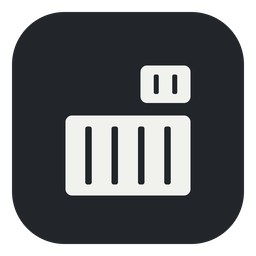
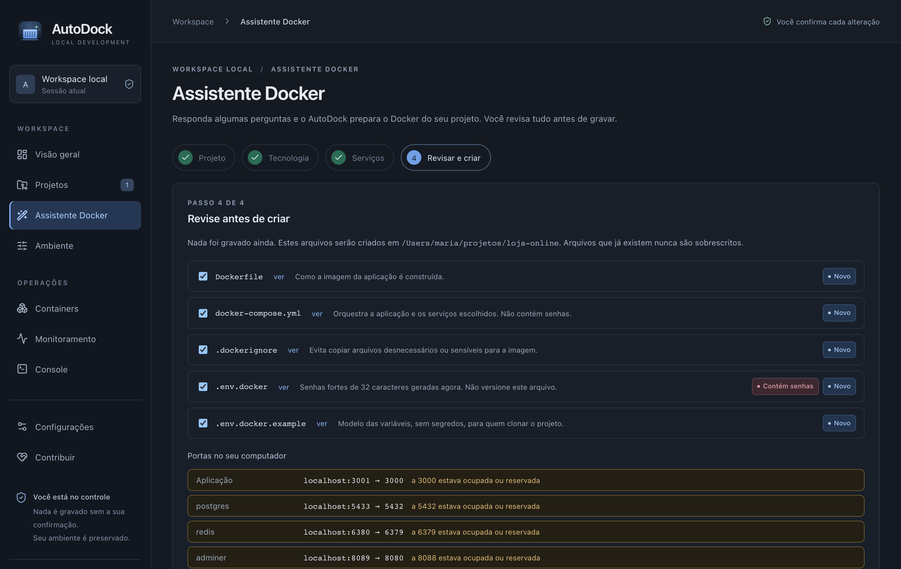

<div align="center">



# AutoDock

**Put any project in Docker in a few clicks.**<br/>
Answer a few questions. AutoDock writes the `Dockerfile`, the `docker-compose.yml` and even the project itself if you don't have one yet. You review everything before anything is written.

[](LICENSE)
[](https://github.com/joaopanucci/autodock/releases/latest)


[Português](README.md)



</div>

> The app interface is currently in Brazilian Portuguese. English UI is on the roadmap.

## What it does

- **Existing project:** detects the stack from its manifests and generates `Dockerfile`, `docker-compose.yml`, `.dockerignore` and `.env.docker.example`.
- **New project in an empty folder:** a clean starter, or the **official framework installer** (Laravel, Django, Vite + React/Vue) run *inside* Docker, so nothing but Docker has to be installed.
- **Ready-made services:** PostgreSQL, MySQL, MongoDB, Redis, RabbitMQ, Adminer and MailHog, wired to your app with healthchecks.
- **Strong secrets:** every service gets a random 32-character password (OS CSPRNG) stored in `.env.docker`; `docker-compose.yml` contains no passwords.
- **No port clashes:** free host ports are picked automatically and remembered across your projects.
- **Open in your IDE:** VS Code, Cursor, Windsurf, IntelliJ, WebStorm, PyCharm, PhpStorm, Zed or Sublime, whichever is installed.

Supported stacks: **Node.js** (npm/pnpm/yarn, Vite), **Java/Spring Boot** (Maven), **Python** (FastAPI, Django, Flask) and **PHP/Laravel**.

## Download

Get the installer from the [releases page](https://github.com/joaopanucci/autodock/releases/latest): macOS (`.dmg`, universal), Windows (`.exe`), Linux (`.deb`, `.AppImage`). Docker must be installed and running.

The installers are **not code-signed yet**, so your OS shows a warning on first launch (macOS: *System Settings → Privacy & Security → Open Anyway*; Windows: *More info → Run anyway*). Each release ships a `SHA256SUMS.txt`.

## Safety principles

Preview before writing (the previewed passwords are exactly what gets written); never overwrites files; passwords only in a private `.env.docker`; allowlisted inputs (no injection into Dockerfile/YAML/commands); no host shell; framework installers run in a throwaway container with only the empty folder mounted; service ports bound to `127.0.0.1`; never reads `.env` files or runs project scripts.

## CLI and development

```bash
autodock generate ./my-project --stack nodejs --port 3000 --service postgres          # preview
autodock generate ./my-project --stack nodejs --port 3000 --service postgres --write  # write new files only
```

See the [development guide](docs/DEVELOPMENT.md) (Portuguese) to build from source: `npm --prefix apps/desktop ci && npm --prefix apps/desktop run tauri dev`.

## Contributing

Stars, issues, pull requests and Windows/Linux testing are all welcome. See [CONTRIBUTING](CONTRIBUTING.md). Licensed under [Apache-2.0](LICENSE).
