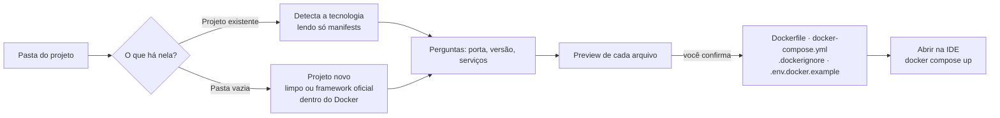

<div align="center">


# AutoDock

**Coloque qualquer projeto no Docker em poucos cliques.**<br/>
Responda algumas perguntas. O AutoDock cria o `Dockerfile`, o `docker-compose.yml` e até o projeto, se você ainda não tiver um. Você revisa tudo antes de gravar.

[](https://github.com/joaopanucci/autodock/actions/workflows/rust-ci.yml)
[](https://github.com/joaopanucci/autodock/releases/latest)
[](LICENSE)


[](CONTRIBUTING.md)

[**Baixar**](#-baixar) · [**Passo a passo**](#-passo-a-passo) · [**CLI**](#-linha-de-comando) · [**Contribuir**](#-contribuir) · [English](README.en.md)

<br/>


</div>

<br/>

## ✨ Por que o AutoDock?

Configurar Docker para um projeto local é repetitivo: qual imagem base, qual porta, como ligar o banco, o que ignorar na imagem. O AutoDock transforma isso em uma conversa.

- 🧭 **Guiado.** Pergunta o que importa (tecnologia, porta, versão, bancos, cache) e cuida do resto.
- 👀 **Transparente.** Mostra cada arquivo e cada comando **antes** de qualquer alteração.
- 🛡️ **Seguro por padrão.** Nunca sobrescreve arquivos, nunca lê o seu `.env`, nunca executa scripts do seu projeto.
- 🔐 **Senhas fortes de verdade.** Cada serviço ganha uma senha aleatória de 32 caracteres (gerador criptográfico do sistema), guardada em `.env.docker`. O `docker-compose.yml` não contém nenhuma senha.
- 🔌 **Sem conflito de portas.** O AutoDock testa quais portas estão livres e lembra as de outros projetos, então 10 projetos não disputam a 5432.
- 🧰 **Sem instalar nada além do Docker.** Os instaladores oficiais dos frameworks rodam *dentro* de containers.
- 🖥️ **Local e open source.** Seu código não sai do seu computador. Licença Apache-2.0.

## 🚀 O que ele faz

| | |
|---|---|
| **Projeto existente** | Detecta a tecnologia lendo os manifests e gera `Dockerfile`, `docker-compose.yml`, `.dockerignore` e `.env.docker.example`. |
| **Projeto novo, em pasta vazia** | Cria um projeto *limpo* ou usa o **instalador oficial** do framework, tudo dentro do Docker. |
| **Serviços prontos** | PostgreSQL, MySQL, MongoDB, Redis, RabbitMQ, Adminer e MailHog, já conectados ao app por variáveis de ambiente, com healthchecks, **senhas fortes geradas** e **portas livres escolhidas automaticamente**. |
| **Abrir na sua IDE** | Depois de criar, abre o projeto no VS Code, Cursor, Windsurf, IntelliJ, WebStorm, PyCharm, PhpStorm, Zed ou Sublime que você tiver instalado. |
| **Visão do ambiente** | Analisa projetos, diagnostica o seu ambiente, lista containers, mostra métricas e logs, tudo em modo leitura. |

### Tecnologias

| Tecnologia | Projeto existente | Projeto novo (limpo) | Projeto novo (framework oficial) |
|---|:---:|:---:|:---:|
| **Node.js** | ✅ npm · pnpm · yarn, Vite | ✅ Express | ✅ Vite + React · Vite + Vue (TypeScript) |
| **Java / Spring Boot** | ✅ Maven | ✅ Spring Boot + Maven | 🔜 Spring Initializr |
| **Python** | ✅ FastAPI · Django · Flask | ✅ FastAPI · Flask | ✅ Django |
| **PHP / Laravel** | ✅ Composer | — | ✅ Laravel |

## 📦 Baixar

Pegue o instalador da sua plataforma na [página de releases](https://github.com/joaopanucci/autodock/releases/latest):

| Sistema | Arquivo | Como instalar |
|---|---|---|
| 🍎 **macOS** (Intel e Apple Silicon) | [`AutoDock_0.1.1_universal.dmg`](https://github.com/joaopanucci/autodock/releases/download/v0.1.1/AutoDock_0.1.1_universal.dmg) | Abra o DMG e arraste para *Aplicativos*. |
| 🪟 **Windows** (64 bits) | [`AutoDock_0.1.1_x64-setup.exe`](https://github.com/joaopanucci/autodock/releases/download/v0.1.1/AutoDock_0.1.1_x64-setup.exe) | Execute o instalador. |
| 🐧 **Linux** (Debian/Ubuntu) | [`AutoDock_0.1.1_amd64.deb`](https://github.com/joaopanucci/autodock/releases/download/v0.1.1/AutoDock_0.1.1_amd64.deb) | `sudo apt install ./AutoDock_0.1.1_amd64.deb` |
| 🐧 **Linux** (qualquer distro) | [`AutoDock_0.1.1_amd64.AppImage`](https://github.com/joaopanucci/autodock/releases/download/v0.1.1/AutoDock_0.1.1_amd64.AppImage) | `chmod +x AutoDock_*.AppImage && ./AutoDock_*.AppImage` |

> **Requisito:** [Docker](https://docs.docker.com/get-docker/) instalado e em execução para criar e rodar os ambientes.

<details>
<summary><b>⚠️ "App de desenvolvedor não identificado"? É esperado, e aqui está o porquê</b></summary>

<br/>

O AutoDock é um projeto open source e os instaladores **ainda não são assinados** (assinar exige contas pagas na Apple e na Microsoft). Por isso o sistema mostra um aviso na primeira abertura. O código é público e cada release traz um `SHA256SUMS.txt` para você conferir o arquivo baixado.

- **macOS:** abra o app uma vez, depois vá em **Ajustes do Sistema → Privacidade e Segurança** e clique em **Abrir mesmo assim**. Alternativa no terminal: `xattr -dr com.apple.quarantine /Applications/AutoDock.app`.
- **Windows:** na tela do SmartScreen, clique em **Mais informações** e depois em **Executar assim mesmo**.
- **Linux:** não há aviso.

Conferir a integridade do arquivo:

```bash
shasum -a 256 AutoDock_0.1.1_universal.dmg   # compare com o SHA256SUMS.txt
```

</details>

> 🧪 **Status das plataformas:** a CI compila e testa o núcleo em macOS, Windows e Linux, e gera os três instaladores a cada versão. Os testes manuais do aplicativo completo foram feitos no macOS; relatos de Windows e Linux são muito bem-vindos.

## 🎬 Passo a passo

### 1. Escolha a pasta do projeto

Selecione a pasta. O AutoDock lê **apenas** os arquivos de configuração (`package.json`, `pom.xml`, `requirements.txt`, `composer.json`) para sugerir a tecnologia. Nenhum código seu é executado.


> 💡 **Pasta vazia?** O assistente oferece **Criar projeto novo**: você escolhe a tecnologia, define o nome e decide entre um projeto **limpo** ou o **instalador oficial** do framework (Laravel, Django, Vite + React/Vue). Antes de rodar, ele mostra o comando exato.

### 2. Confirme a tecnologia e responda o essencial

Porta, versão do runtime, gerenciador de pacotes, script de início. Tudo com valores padrão sensatos.


### 3. Escolha os serviços

Marque o que o projeto precisa. Cada item vira um container ao lado do seu app, já conectado.


### 4. Revise antes de criar

Veja o conteúdo de cada arquivo. Nada foi gravado ainda. Arquivos que já existem **nunca** são sobrescritos.


### 5. Pronto: abra na sua IDE e suba o ambiente

Um clique abre o projeto no editor que você tem instalado. Depois, é só rodar:

```bash
docker compose up --build
```


### Além do assistente

<table>
<tr>
<td width="50%"><b>Analise um projeto</b><br/>Tecnologias, módulos e evidências, com a origem de cada informação.<br/></td>
<td width="50%"><b>Veja seus containers</b><br/>Inventário do Docker local, agrupado por projeto, com estado e saúde.<br/></td>
</tr>
<tr>
<td width="50%"><b>Diagnostique o ambiente</b><br/>Node, Git, Docker, Compose e Engine, sem supor nada.<br/></td>
<td width="50%"><b>Visão geral</b><br/>Seus projetos e o estado do ambiente em um só lugar.<br/></td>
</tr>
</table>

## 🔄 Como funciona



## 🛡️ Princípios de segurança

O AutoDock mexe nos seus arquivos, então a confiança vem primeiro:

- **Preview antes de gravar.** O conteúdo é gerado no backend a partir de opções validadas; a interface nunca envia o conteúdo dos arquivos.
- **Nunca sobrescreve.** Criação exclusiva de arquivos; symlinks não são seguidos.
- **Senhas fora do compose.** Senhas de 32 caracteres (CSPRNG do sistema) ficam em `.env.docker`, com permissão restrita, e a pré-visualização mostra exatamente o que será gravado. O arquivo `.env.docker.example` traz só os nomes das variáveis.
- **Entradas por lista permitida.** Portas, versões, nomes e scripts são validados, então não há injeção em Dockerfile, YAML ou linha de comando.
- **Sem shell.** Editores e instaladores são iniciados com argumentos fixos, nunca por texto montado.
- **Instaladores de framework isolados.** Rodam em um container descartável com **apenas** a pasta vazia montada.
- **Portas dos serviços só em `127.0.0.1`.** Bancos e filas não ficam expostos na sua rede.
- **Nunca lê `.env`** nem executa scripts dos projetos analisados.

Detalhes em [`docs/SECURITY.md`](docs/SECURITY.md).

## ⌨️ Linha de comando

Tudo que o assistente faz também está disponível no terminal (`cargo run -p autodock-cli -- …`):

```bash
# analisa um projeto e diagnostica o ambiente
autodock scan ./meu-projeto
autodock doctor

# mostra o preview (nada é gravado)...
autodock generate ./meu-projeto --stack nodejs --port 3000 --service postgres --service redis
# ...e grava só os arquivos novos
autodock generate ./meu-projeto --stack nodejs --port 3000 --service postgres --write

# projeto novo em pasta vazia
autodock generate ./novo --new --stack python --port 8000 --write
autodock scaffold ./novo --framework laravel --name loja          # só mostra o comando
autodock scaffold ./novo --framework laravel --name loja --run    # executa
```

## 🧱 Arquitetura

```
crates/autodock-core   Núcleo em Rust: scanner, gerador, instaladores, IDEs, Docker (sem UI)
crates/autodock-cli    Linha de comando (Clap)
apps/desktop           Interface React + Vite, empacotada com Tauri 2
docs/                  Arquitetura, segurança, roadmap e guia de desenvolvimento
```

Rodar a partir do código-fonte: veja o [guia de desenvolvimento](docs/DEVELOPMENT.md).

```bash
npm --prefix apps/desktop ci
npm --prefix apps/desktop run tauri dev
```

## 🗺️ Roadmap

- [x] Assistente Docker para projetos existentes (Node.js, Spring Boot, Python, Laravel)
- [x] Serviços: PostgreSQL, MySQL, MongoDB, Redis, RabbitMQ, Adminer, MailHog
- [x] Projeto novo: limpo ou com instalador oficial (Laravel, Django, Vite)
- [x] Abrir o projeto na IDE instalada
- [x] Instaladores para macOS, Windows e Linux
- [ ] Spring Initializr (escolher dependências)
- [ ] Gradle e mais frameworks (Next.js, NestJS, Rails…)
- [ ] Dockerfiles de produção (multi-stage)
- [ ] Assinatura e notarização dos instaladores
- [ ] Interface em inglês

## 🤝 Contribuir

O AutoDock é feito de forma aberta e toda ajuda conta:

- ⭐ **Dê uma estrela** para ajudar outras pessoas a encontrarem o projeto.
- 🐛 **Relate problemas** e 💡 **sugira ideias** nas [issues](https://github.com/joaopanucci/autodock/issues).
- 🔧 **Envie um pull request.** Leia o [CONTRIBUTING](CONTRIBUTING.md) e o [guia de desenvolvimento](docs/DEVELOPMENT.md).
- 🧪 **Teste no Windows e no Linux** e conte como foi.
- 💙 **Apoie com um PIX.** O app tem uma aba **Contribuir** com um QR Code. É voluntário e nenhum recurso depende dele.

## 📄 Licença

[Apache-2.0](LICENSE) © AutoDock contributors.

<div align="center"><sub>Feito com 🦀 Rust, ⚛️ React e 🐳 Docker.</sub></div>
