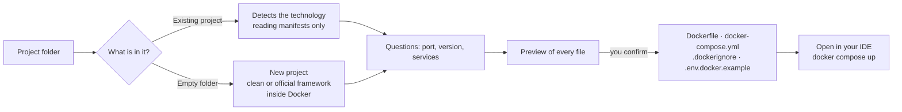

<div align="center">

**🌐 English · [Português (Brasil)](README.pt-BR.md)**


# AutoDock

**Put any project in Docker in a few clicks.**<br/>
Answer a few questions. AutoDock writes the `Dockerfile`, the `docker-compose.yml` and even the project itself if you don't have one yet. You review everything before anything is written.

[](https://github.com/joaopanucci/autodock/actions/workflows/rust-ci.yml)
[](https://github.com/joaopanucci/autodock/releases/latest)
[](LICENSE)


[](CONTRIBUTING.md)

[**Download**](#-download) · [**Step by step**](#-step-by-step) · [**CLI**](#-command-line) · [**Contribute**](#-contributing)

<br/>


</div>

<br/>

## ✨ Why AutoDock?

Setting up Docker for a local project is repetitive: which base image, which port, how to wire the database, what to leave out of the image. AutoDock turns that into a conversation.

- 🧭 **Guided.** It asks what matters (technology, port, version, databases, cache) and handles the rest.
- 👀 **Transparent.** It shows every file and every command **before** anything changes.
- 🛡️ **Safe by default.** It never overwrites files, never reads your `.env`, never runs your project's scripts.
- 🔐 **Really strong passwords.** Every service gets a random 32-character password (from the operating system's cryptographic generator), kept in `.env.docker`. `docker-compose.yml` contains no passwords.
- 🔌 **No port clashes.** AutoDock checks which ports are free and remembers the ones used by your other projects, so ten projects never fight over 5432.
- 🧰 **Nothing to install except Docker.** The frameworks' official installers run *inside* containers.
- 🖥️ **Local and open source.** Your code never leaves your computer. Apache-2.0 license.
- 🌍 **English and Portuguese.** The interface and messages follow your system language and can be switched in Settings.

## 🚀 What it does

| | |
|---|---|
| **Existing project** | Detects the technology from its manifests and generates `Dockerfile`, `docker-compose.yml`, `.dockerignore` and `.env.docker.example`. |
| **New project in an empty folder** | Creates a *clean* project, or uses the framework's **official installer**, all inside Docker. |
| **Ready-made services** | PostgreSQL, MySQL, MongoDB, Redis, RabbitMQ, Adminer and MailHog, already wired to your app through environment variables, with healthchecks, **generated strong passwords** and **automatically chosen free ports**. |
| **Open in your IDE** | After creating, opens the project in whichever of VS Code, Cursor, Windsurf, IntelliJ, WebStorm, PyCharm, PhpStorm, Zed or Sublime you have installed. |
| **Environment view** | Analyzes projects, diagnoses your environment, lists containers, shows metrics and logs, all read-only. |

### Technologies

| Technology | Existing project | New project (clean) | New project (official framework) |
|---|:---:|:---:|:---:|
| **Node.js** | ✅ npm · pnpm · yarn, Vite | ✅ Express | ✅ Vite + React · Vite + Vue (TypeScript) |
| **Java / Spring Boot** | ✅ Maven | ✅ Spring Boot + Maven | 🔜 Spring Initializr |
| **Python** | ✅ FastAPI · Django · Flask | ✅ FastAPI · Flask | ✅ Django |
| **PHP / Laravel** | ✅ Composer | — | ✅ Laravel |

## 📦 Download

Get the installer for your platform from the [releases page](https://github.com/joaopanucci/autodock/releases/latest):

| System | File | How to install |
|---|---|---|
| 🍎 **macOS** (Intel and Apple Silicon) | [`AutoDock_0.1.2_universal.dmg`](https://github.com/joaopanucci/autodock/releases/download/v0.1.2/AutoDock_0.1.2_universal.dmg) | Open the DMG and drag the app to *Applications*. |
| 🪟 **Windows** (64-bit) | [`AutoDock_0.1.2_x64-setup.exe`](https://github.com/joaopanucci/autodock/releases/download/v0.1.2/AutoDock_0.1.2_x64-setup.exe) | Run the installer. |
| 🐧 **Linux** (Debian/Ubuntu) | [`AutoDock_0.1.2_amd64.deb`](https://github.com/joaopanucci/autodock/releases/download/v0.1.2/AutoDock_0.1.2_amd64.deb) | `sudo apt install ./AutoDock_0.1.2_amd64.deb` |
| 🐧 **Linux** (any distro) | [`AutoDock_0.1.2_amd64.AppImage`](https://github.com/joaopanucci/autodock/releases/download/v0.1.2/AutoDock_0.1.2_amd64.AppImage) | `chmod +x AutoDock_*.AppImage && ./AutoDock_*.AppImage` |

> **Requirement:** [Docker](https://docs.docker.com/get-docker/) installed and running, to create and run the environments.

### ⚡ Quick install, no security warning

One command downloads the latest release, **verifies its SHA-256** and installs it:

```bash
# macOS
curl -fsSL https://raw.githubusercontent.com/joaopanucci/autodock/main/scripts/install.sh | bash
```

```powershell
# Windows (PowerShell)
irm https://raw.githubusercontent.com/joaopanucci/autodock/main/scripts/install.ps1 | iex
```

Because the download does not go through a browser, the file never gets the "downloaded from the internet" mark that triggers macOS Gatekeeper and Windows SmartScreen. No protection of your system is turned off, and the app stays unsigned. The scripts are short and open: [`install.sh`](scripts/install.sh) and [`install.ps1`](scripts/install.ps1). To pin a version: `AUTODOCK_VERSION=v0.1.2`.

<details>
<summary><b>⚠️ Downloaded with a browser and got "unidentified developer"? That is expected</b></summary>

<br/>

AutoDock is open source and the installers are **not code-signed yet** (signing requires paid Apple and Microsoft programs). That is why your system shows a warning on first launch. The code is public and every release ships a `SHA256SUMS.txt` so you can verify the file you downloaded.

- **macOS:** open the app once, then go to **System Settings → Privacy & Security** and click **Open Anyway**. Terminal alternative: `xattr -dr com.apple.quarantine /Applications/AutoDock.app`.
- **Windows:** on the SmartScreen screen, click **More info** and then **Run anyway**.
- **Linux:** there is no warning.

Verify the file's integrity:

```bash
shasum -a 256 AutoDock_0.1.2_universal.dmg   # compare with SHA256SUMS.txt
```

</details>

> 🧪 **Platform status:** CI builds and tests the core on macOS, Windows and Linux, and builds the three installers for every release. The complete app was tested manually on macOS; reports from Windows and Linux are very welcome.

## 🎬 Step by step

### 1. Pick the project folder

Select the folder. AutoDock reads **only** configuration files (`package.json`, `pom.xml`, `requirements.txt`, `composer.json`) to suggest the technology. None of your code is run.


> 💡 **Empty folder?** The assistant offers **Create new project**: you pick the technology, name it and choose between a **clean** project or the framework's **official installer** (Laravel, Django, Vite + React/Vue). Before running it, it shows the exact command.

### 2. Confirm the technology and answer the essentials

Port, runtime version, package manager, start script. All with sensible defaults.


### 3. Choose the services

Tick what the project needs. Each item becomes a container next to your app, already connected.


### 4. Review before creating

See the content of every file. Nothing has been written yet. Files that already exist are **never** overwritten.


### 5. Done: open it in your IDE and start the environment

One click opens the project in the editor you have installed. Then just run:

```bash
docker compose up --build
```


### Beyond the assistant

<table>
<tr>
<td width="50%"><b>Analyze a project</b><br/>Technologies, modules and evidence, with the source of every piece of information.<br/></td>
<td width="50%"><b>See your containers</b><br/>Inventory of your local Docker, grouped by project, with state and health.<br/></td>
</tr>
<tr>
<td width="50%"><b>Diagnose the environment</b><br/>Node, Git, Docker, Compose and Engine, without assuming anything.<br/></td>
<td width="50%"><b>Overview</b><br/>Your projects and the state of your environment in one place.<br/></td>
</tr>
</table>

## 🔄 How it works



## 🛡️ Security principles

AutoDock touches your files, so trust comes first:

- **Preview before writing.** The content is generated in the backend from validated options; the interface never sends file contents.
- **Never overwrites.** Files are created exclusively; symlinks are not followed.
- **Passwords outside the compose file.** 32-character passwords (system CSPRNG) go to `.env.docker`, with restricted permissions, and the preview shows exactly what will be written. `.env.docker.example` only lists variable names.
- **Allowlisted inputs.** Ports, versions, names and scripts are validated, so there is no injection into Dockerfiles, YAML or command lines.
- **No shell.** Editors and installers are started with fixed arguments, never with assembled text.
- **Isolated framework installers.** They run in a throwaway container with **only** the empty folder mounted.
- **Service ports on `127.0.0.1` only.** Databases and queues are not exposed to your network.
- **Never reads `.env`** nor runs scripts of the analyzed projects.

Details in [`docs/SECURITY.md`](docs/SECURITY.md).

## ⌨️ Command line

Everything the assistant does is also available in the terminal (`cargo run -p autodock-cli -- …`):

```bash
# the CLI follows your system language; force it with --lang pt or --lang en
# analyze a project and diagnose the environment
autodock scan ./my-project
autodock doctor

# show the preview (nothing is written)...
autodock generate ./my-project --stack nodejs --port 3000 --service postgres --service redis
# ...and write only the new files
autodock generate ./my-project --stack nodejs --port 3000 --service postgres --write

# new project in an empty folder
autodock generate ./new --new --stack python --port 8000 --write
autodock scaffold ./new --framework laravel --name shop          # only shows the command
autodock scaffold ./new --framework laravel --name shop --run    # runs it
```

## 🧱 Architecture

```
crates/autodock-core   Rust core: scanner, generator, installers, IDEs, Docker (no UI)
crates/autodock-cli    Command line (Clap)
apps/desktop           React + Vite interface, packaged with Tauri 2
docs/                  Architecture, security, roadmap and development guide
```

To run from source, see the [development guide](docs/DEVELOPMENT.md).

```bash
npm --prefix apps/desktop ci
npm --prefix apps/desktop run tauri dev
```

## 🗺️ Roadmap

- [x] Docker assistant for existing projects (Node.js, Spring Boot, Python, Laravel)
- [x] Services: PostgreSQL, MySQL, MongoDB, Redis, RabbitMQ, Adminer, MailHog
- [x] New project: clean or with the official installer (Laravel, Django, Vite)
- [x] Open the project in the installed IDE
- [x] Installers for macOS, Windows and Linux
- [x] Interface in English and Portuguese
- [ ] Spring Initializr (choose dependencies)
- [ ] Gradle and more frameworks (Next.js, NestJS, Rails…)
- [ ] Production Dockerfiles (multi-stage)
- [ ] Code signing and notarization of the installers

## 🤝 Contributing

AutoDock is built in the open and every bit of help counts:

- ⭐ **Star the repository** to help other people find the project.
- 🐛 **Report problems** and 💡 **suggest ideas** in the [issues](https://github.com/joaopanucci/autodock/issues).
- 🔧 **Send a pull request.** Read [CONTRIBUTING](CONTRIBUTING.md) and the [development guide](docs/DEVELOPMENT.md).
- 🧪 **Test on Windows and Linux** and tell us how it went.
- 💙 **Support with a PIX.** The app has a **Contribute** tab with a QR code (PIX is a Brazilian instant payment system). It is voluntary and no feature depends on it.

## 📄 License

[Apache-2.0](LICENSE) © AutoDock contributors.

<div align="center"><sub>Made with 🦀 Rust, ⚛️ React and 🐳 Docker.</sub></div>
