<div align="center">

**🌐 English · [Português (Brasil)](README.pt-BR.md)**

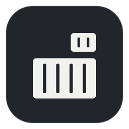

# AutoDock

**Put any project in Docker in a few clicks.**<br/>
Answer a few questions. AutoDock writes the `Dockerfile`, the `docker-compose.yml` and even the project itself if you don't have one yet. You review everything before anything is written.<br/>
Then keep your projects current: upgrade old Java (Maven) projects to **Java 25 and Spring Boot 4**, update **Expo** SDKs, and review the result in a **built-in code editor** with a terminal that runs in Docker.

[](https://github.com/joaopanucci/autodock/actions/workflows/rust-ci.yml)
[](https://github.com/joaopanucci/autodock/releases/latest)
[](LICENSE)


[](CONTRIBUTING.md)
[](https://discord.gg/AqKSFaQ8g3)

[**Download**](#-download) · [**Step by step**](#-step-by-step) · [**CLI**](#-command-line) · [**Contribute**](#-contributing) · [**Discord**](https://discord.gg/AqKSFaQ8g3)

<br/>

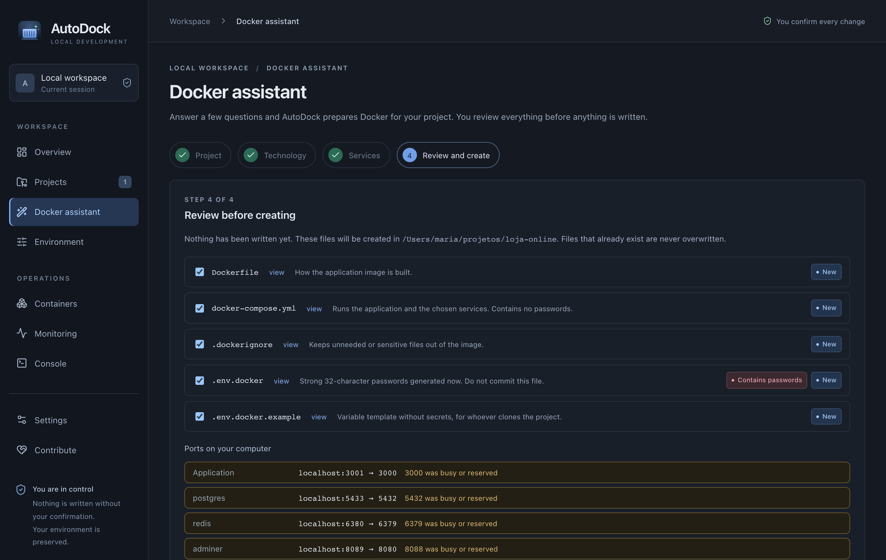

</div>

<br/>

## ✨ Why AutoDock?

Setting up Docker for a local project is repetitive: which base image, which port, how to wire the database, what to leave out of the image. AutoDock turns that into a conversation.

- 🧭 **Guided.** It asks what matters (technology, port, version, databases, cache) and handles the rest.
- 👀 **Transparent.** It shows every file and every command **before** anything changes.
- 🛡️ **Safe by default.** It never overwrites files, never reads your `.env`, never runs your project's scripts.
- 🔐 **Really strong passwords.** Every service gets a random 32-character password (from the operating system's cryptographic generator), kept in `.env.docker`. `docker-compose.yml` contains no passwords.
- 🔌 **No port clashes.** AutoDock checks which ports are free and remembers the ones used by your other projects, so ten projects never fight over 5432.
- 🧰 **Nothing to install except Docker.** The frameworks' official installers run *inside* containers.
- 🖥️ **Local and open source.** Your code never leaves your computer. Apache-2.0 license.
- 🏷️ **Named after your project.** The compose project, the containers and the images carry your project's name (`shop`, `shop-postgres`…), never a generic one.
- 🌗 **Light and dark.** Switch the theme from any screen; it can also follow your system.
- 🎓 **Learn as you go.** 13 short lessons, a quick reference with commands for PowerShell, CMD and Bash, and a glossary, all inside the app.
- 🌍 **English and Portuguese.** The interface and messages follow your system language and can be switched in Settings.

## 🚀 What it does

| | |
|---|---|
| **Existing project** | Detects the technology from its manifests and generates `Dockerfile`, `docker-compose.yml`, `.dockerignore` and `.env.docker.example`. |
| **New project in an empty folder** | Creates a *clean* project, or uses the framework's **official installer**, all inside Docker. |
| **Ready-made services** | PostgreSQL, MySQL, MongoDB, Redis, RabbitMQ, Adminer and MailHog, already wired to your app through environment variables, with healthchecks, **generated strong passwords** and **automatically chosen free ports**. |
| **Several apps (monorepos, microservices)** | Finds every app in the folder (backend, front end, mobile…), writes **one Dockerfile per app** and **one compose file** that runs them together with the shared services, wired to each other (the front end receives the backend's address). Existing Dockerfiles and compose files are reused, never overwritten. |
| **Run everything** | One button (after you confirm) runs `docker compose up -d --build`, shows the state of every service and lets you stop or remove the containers. Volumes (your data) are never removed. |
| **Expo: SDK alerts and upgrade** | Shows the SDK of your Expo projects and tells you when a newer **stable** SDK is out ("your project is on SDK 57, but Expo released SDK 58: upgrade?"). The upgrade follows the official steps (`expo install`, `expo install --fix`, `expo-doctor`) **inside Docker**, one SDK at a time, with a backup of `package.json` and the lock file that is restored by itself if something fails. |
| **Java: upgrade a legacy project** | Reads an old Maven project (Java 6/7/8, Spring Boot 1.x/2.x) and creates, **next to it** (or in a folder you choose), a copy upgraded to **Java 25 and Spring Boot 4**: it walks the copy up one step at a time (Spring Boot 2.7, Java 17, Spring Boot 3.5 with `javax` → `jakarta`, Spring Boot 4, Java 25) with [OpenRewrite](https://docs.openrewrite.org/) **inside Docker**, compiles after each step, adds the dependencies for APIs the JDK no longer ships (JAXB, `javax.annotation`…) and runs the project's own tests. Your project is never modified. A folder with Java code but **no `pom.xml`** (Ant, Eclipse, loose `.jar` files) gets a **map** instead: where the sources really are (from each file's `package`, not from folder names), the build files, the libraries it carries, the classes with `main`, the web application and the Java level its project files declare. From that map AutoDock can **turn the folder into a Maven project, in a copy**: the sources go to `src/main/java` and `src/test/java` (each in the folder its `package` says), resources and the web application to their Maven places, and a generated `pom.xml` declares the Java level, the encoding and the libraries (well-known jars become real dependencies from their file name, the others stay as local jars in `lib/`). The folder itself is never modified, and the copy is a normal Maven project that the upgrade above takes from there. |
| **Code editor** | Open a project folder and edit its files without leaving AutoDock. It uses Monaco, the editor of VS Code: file explorer, tabs, colours for many languages, new files and folders, and save with a check that the file did not change on disk in the meantime. After a Java upgrade, **Review the changes in the editor** opens the upgraded copy next to the original, file by file and side by side, and you can edit and save the copy. **Search in all files** finds text across the project (case option, results grouped by file, a click opens the file with the match selected). The **integrated terminal** is a real shell inside AutoDock: you type commands (`mvn test`, `npm run build`, `git status`…) and see the output with colours, but it runs **in a Docker container** with your project folder mounted, so nothing runs loose on your computer (environments for Java/Maven, Node.js, Python or a plain Debian shell; AutoDock picks the one that fits the folder). It only sees the folder you choose, never follows links that lead outside it, and works offline. |
| **Updates inside the app** | When a new version is released, AutoDock tells you and updates itself with one click (no new download). The update is **verified with a signature** before it is installed, nothing is installed without your click, and the check (once a day, one request to GitHub) can be turned off in Settings. |
| **Open in your IDE** | After creating, opens the project in whichever of VS Code, Cursor, Windsurf, IntelliJ, WebStorm, PyCharm, PhpStorm, Zed or Sublime you have installed. |
| **Environment view** | Analyzes projects, diagnoses your environment, lists containers, shows metrics and logs, all read-only. |

### Technologies

| Technology | Existing project | New project (clean) | New project (official framework) |
|---|:---:|:---:|:---:|
| **Node.js** | ✅ npm · pnpm · yarn, Vite, Next.js, NestJS | ✅ Express | ✅ Vite + React · Vite + Vue · Next.js · NestJS (TypeScript) |
| **Java / Spring Boot** | ✅ Maven | ✅ Spring Boot + Maven | 🔜 Spring Initializr |
| **Python** | ✅ FastAPI · Django · Flask | ✅ FastAPI · Flask | ✅ Django |
| **PHP / Laravel** | ✅ Composer | — | ✅ Laravel |
| **Go** | ✅ `go.mod` (multi-stage build) | ✅ `net/http` | — |
| **.NET / ASP.NET Core** | ✅ `.csproj` (multi-stage build) | ✅ minimal API | — |
| **Ruby on Rails** | ✅ Gemfile | — | — |

## 📦 Download

Get the installer for your platform from the [releases page](https://github.com/joaopanucci/autodock/releases/latest):

| System | File | How to install |
|---|---|---|
| 🍎 **macOS** (Intel and Apple Silicon) | [`AutoDock_0.7.0_universal.dmg`](https://github.com/joaopanucci/autodock/releases/download/v0.7.0/AutoDock_0.7.0_universal.dmg) | Open the DMG and drag the app to *Applications*. |
| 🪟 **Windows** (64-bit) | [`AutoDock_0.7.0_x64-setup.exe`](https://github.com/joaopanucci/autodock/releases/download/v0.7.0/AutoDock_0.7.0_x64-setup.exe) | Run the installer. |
| 🐧 **Linux** (Debian/Ubuntu) | [`AutoDock_0.7.0_amd64.deb`](https://github.com/joaopanucci/autodock/releases/download/v0.7.0/AutoDock_0.7.0_amd64.deb) | `sudo apt install ./AutoDock_0.7.0_amd64.deb` |
| 🐧 **Linux** (any distro) | [`AutoDock_0.7.0_amd64.AppImage`](https://github.com/joaopanucci/autodock/releases/download/v0.7.0/AutoDock_0.7.0_amd64.AppImage) | `chmod +x AutoDock_*.AppImage && ./AutoDock_*.AppImage` |

> **Requirement:** [Docker](https://docs.docker.com/get-docker/) installed and running, to create and run the environments.

### ⚡ Quick install, no security warning

One command downloads the latest release, **verifies its SHA-256** and installs it:

```bash
# macOS
curl -fsSL https://raw.githubusercontent.com/joaopanucci/autodock/main/scripts/install.sh | bash
```

```powershell
# Windows (PowerShell)
irm https://raw.githubusercontent.com/joaopanucci/autodock/main/scripts/install.ps1 | iex
```

Because the download does not go through a browser, the file never gets the "downloaded from the internet" mark that triggers macOS Gatekeeper and Windows SmartScreen. No protection of your system is turned off, and the app stays unsigned. The scripts are short and open: [`install.sh`](scripts/install.sh) and [`install.ps1`](scripts/install.ps1). To pin a version: `AUTODOCK_VERSION=v0.7.0`.

<details>
<summary><b>⚠️ Downloaded with a browser and got "unidentified developer"? That is expected</b></summary>

<br/>

AutoDock is open source and the installers are **not code-signed yet** (signing requires paid Apple and Microsoft programs). That is why your system shows a warning on first launch. The code is public and every release ships a `SHA256SUMS.txt` so you can verify the file you downloaded.

- **macOS:** open the app once, then go to **System Settings → Privacy & Security** and click **Open Anyway**. Terminal alternative: `xattr -dr com.apple.quarantine /Applications/AutoDock.app`.
- **Windows:** on the SmartScreen screen, click **More info** and then **Run anyway**.
- **Linux:** there is no warning.

Verify the file's integrity:

```bash
shasum -a 256 AutoDock_0.7.0_universal.dmg   # compare with SHA256SUMS.txt
```

</details>

> 🧪 **Platform status:** CI builds and tests the core on macOS, Windows and Linux, and builds the three installers for every release. The complete app was tested manually on macOS; reports from Windows and Linux are very welcome.

## 🎬 Step by step

### 1. Pick the project folder

Select the folder. AutoDock reads **only** configuration files (`package.json`, `pom.xml`, `requirements.txt`, `composer.json`, `go.mod`, `*.csproj`, `Gemfile`) to suggest the technology. None of your code is run.

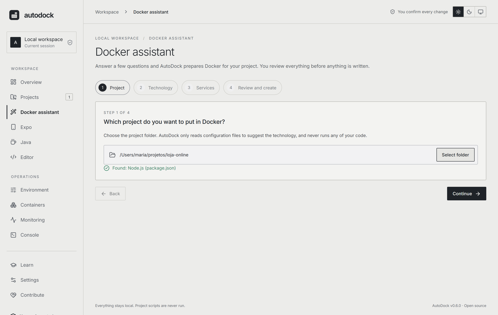

> 💡 **Empty folder?** The assistant offers **Create new project**: you pick the technology, name it and choose between a **clean** project or the framework's **official installer** (Laravel, Django, Vite + React/Vue). Before running it, it shows the exact command.

### 2. Confirm the technology and answer the essentials

Port, runtime version, package manager, start script. All with sensible defaults.

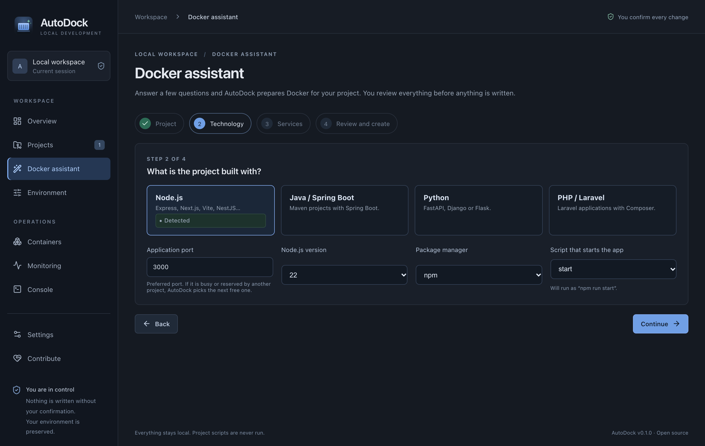

### 3. Choose the services

Tick what the project needs. Each item becomes a container next to your app, already connected.

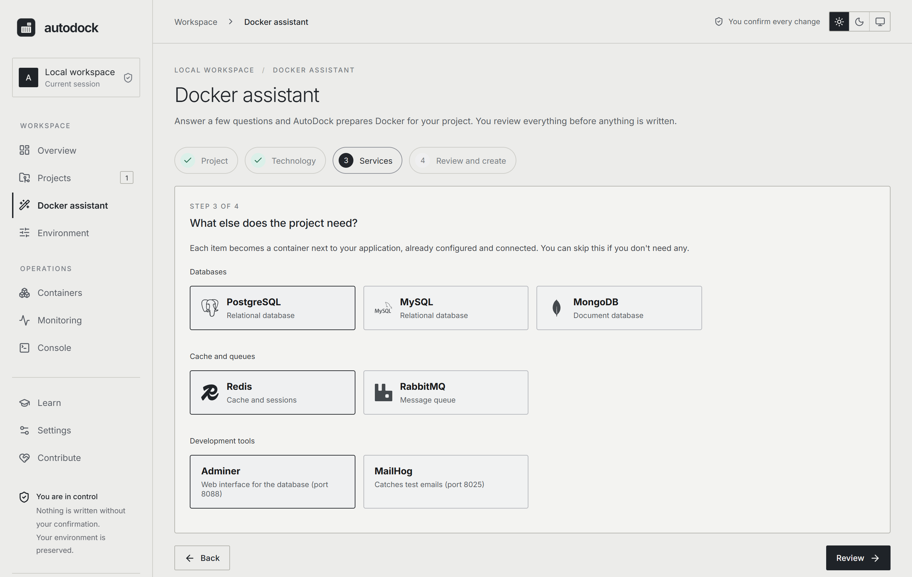

### 4. Review before creating

See the content of every file. Nothing has been written yet. Files that already exist are **never** overwritten.


### 5. Done: open it in your IDE and start the environment

One click opens the project in the editor you have installed. Then just run:

```bash
docker compose up --build
```

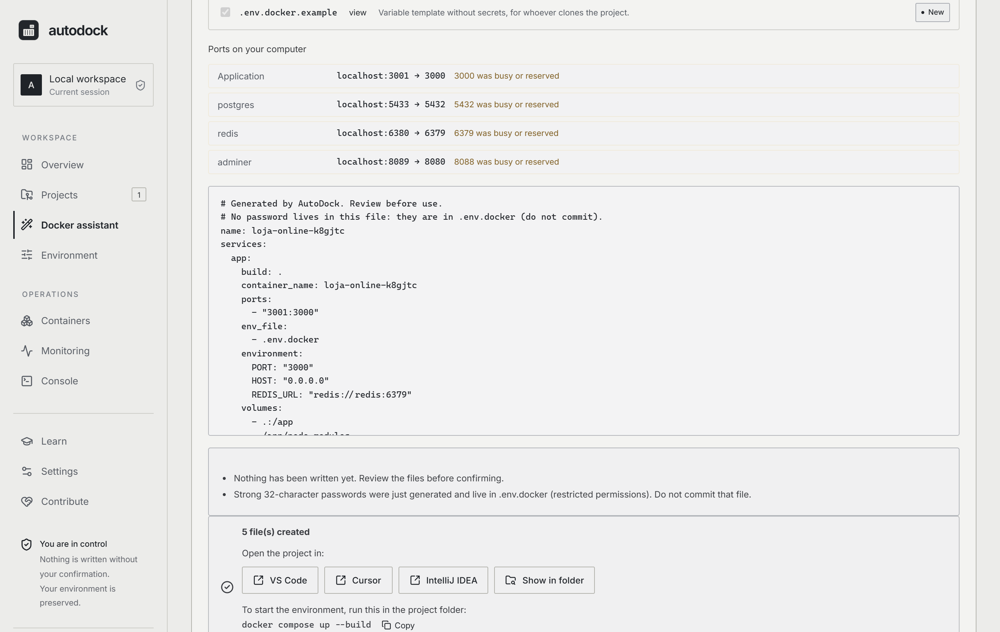

### Beyond the assistant

<table>
<tr>
<td width="50%"><b>Analyze a project</b><br/>Technologies, modules and evidence, with the source of every piece of information.<br/>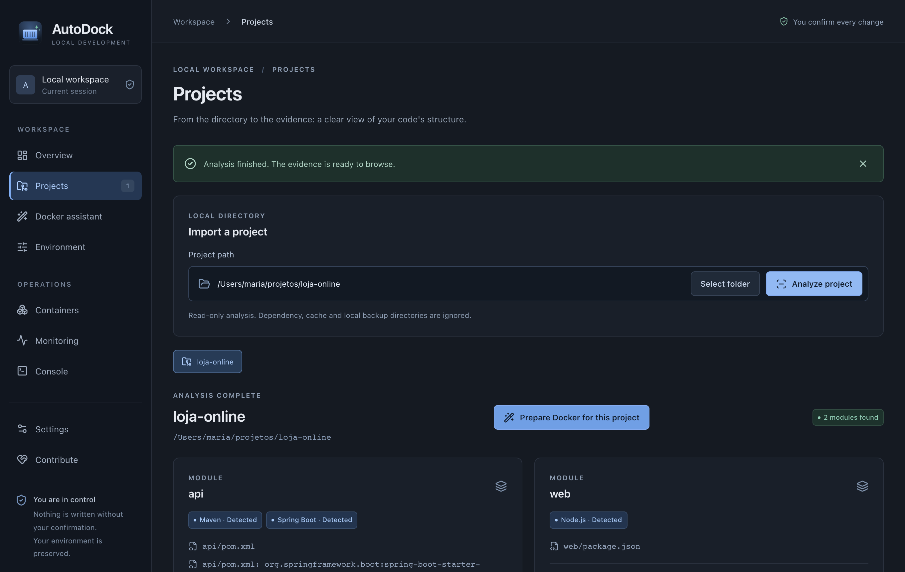</td>
<td width="50%"><b>See your containers</b><br/>Inventory of your local Docker, grouped by project, with state and health.<br/>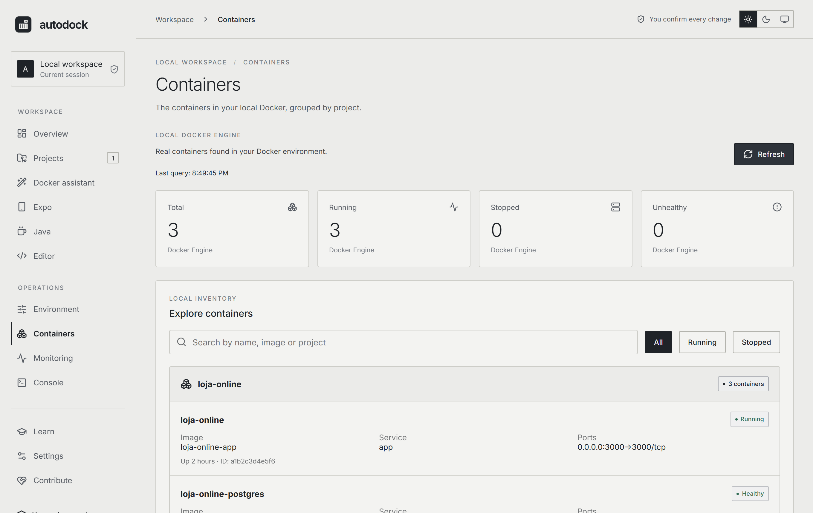</td>
</tr>
<tr>
<td width="50%"><b>Diagnose the environment</b><br/>Node, Git, Docker, Compose and Engine, without assuming anything.<br/>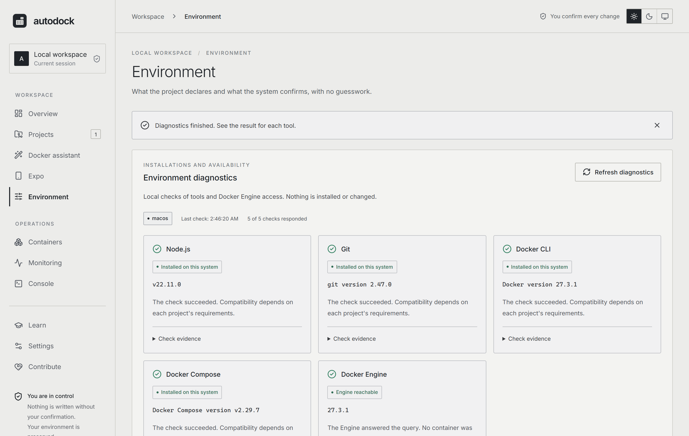</td>
<td width="50%"><b>Overview</b><br/>Your projects and the state of your environment in one place.<br/>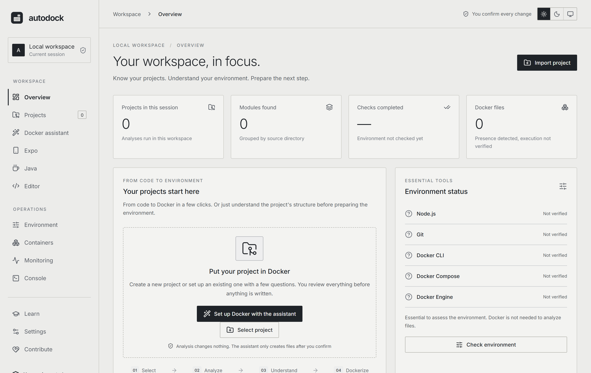</td>
</tr>
</table>

### 📱 Expo: new SDK alerts and upgrade

Add your Expo projects and AutoDock tells you when a newer **stable** SDK is out. The upgrade runs the official steps (`expo install`, `expo install --fix`, `expo-doctor`) inside Docker, one SDK at a time, after you confirm, with a backup of `package.json` and the lock file that you can restore. [More details in the security notes](docs/SECURITY.md).

<table>
<tr>
<td width="33%"><b>The alert</b><br/>On every screen, until you upgrade or dismiss it.<br/>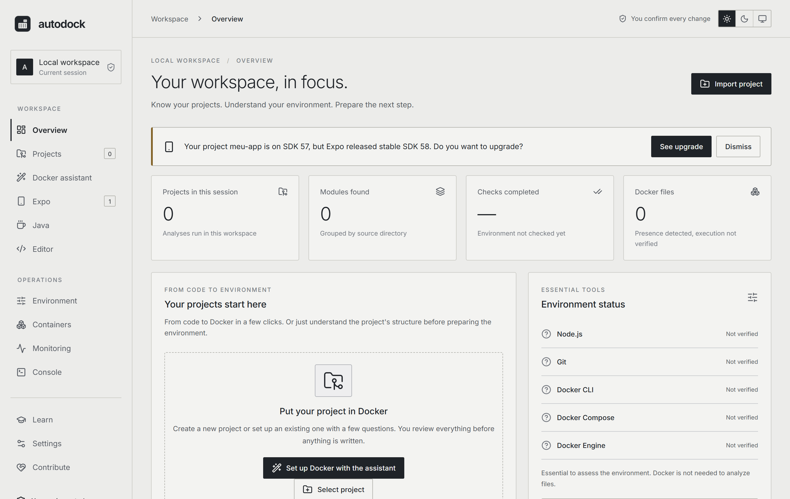</td>
<td width="33%"><b>The plan</b><br/>What will happen, which files change and what to read first.<br/>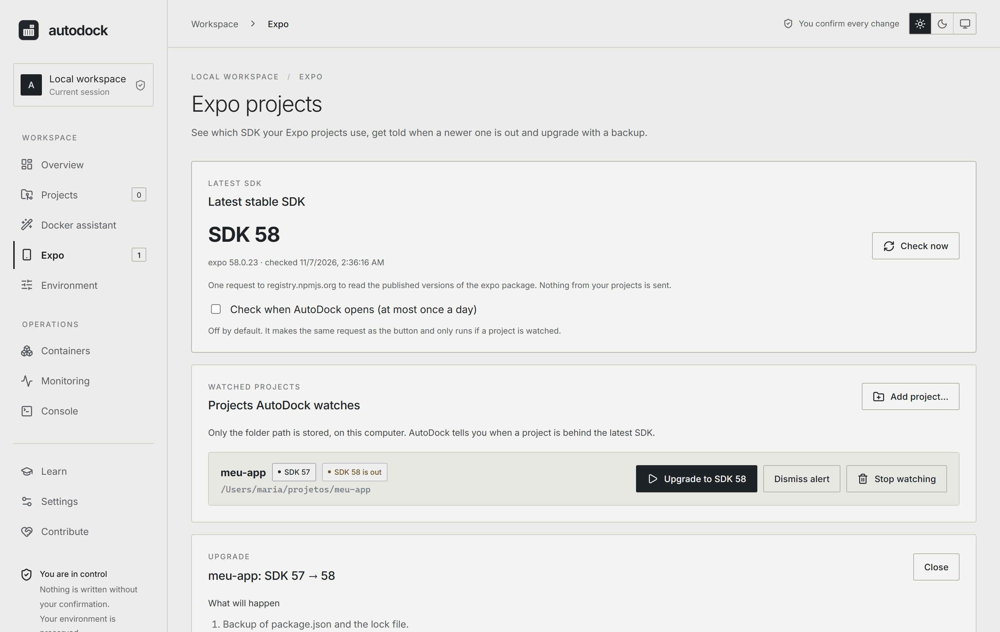</td>
<td width="33%"><b>The report</b><br/>Changed dependencies, the expo-doctor result and the next steps.<br/>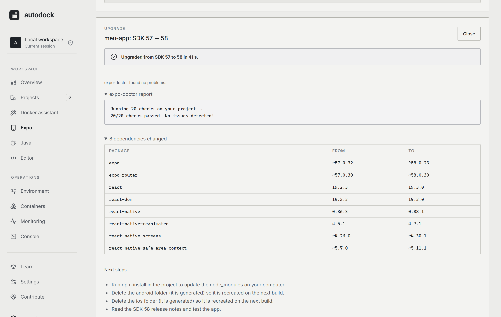</td>
</tr>
</table>

### ☕ Java: upgrade a legacy project

Pick a Maven project and AutoDock shows its Java level and Spring Boot version, plans the upgrade and, after you confirm, creates an upgraded copy (`<name>-java25`) next to the folder, or in the folder you choose. Each step is compiled, so when something breaks the report names the step and shows the compiler errors, and **that step is undone**: the copy stays at the last step that worked (with the project's tests run there). Projects whose Spring Boot is pinned by a third-party BOM (JHipster, for one) only get the Java level upgraded, because the Spring Boot recipes cannot move that BOM. Spring Boot projects go up one major line at a time; projects without Spring only move the Java level. Gradle is not supported yet. [More details in the security notes](docs/SECURITY.md).

<table>
<tr>
<td width="50%"><b>The plan</b><br/>The steps in order, the dependencies it adds and where the copy goes. Nothing runs until you confirm.<br/>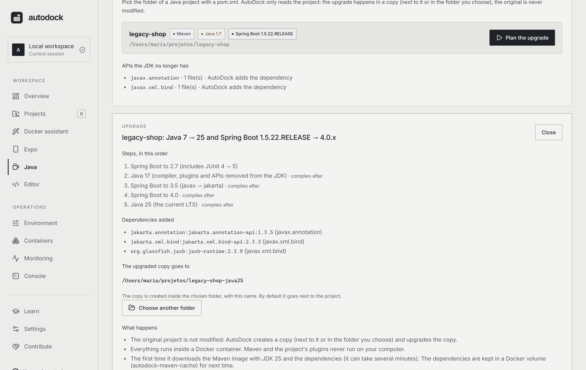</td>
<td width="50%"><b>The report</b><br/>Every step compiled, the project's own tests run on the copy, and a button to review the changes in the editor.<br/>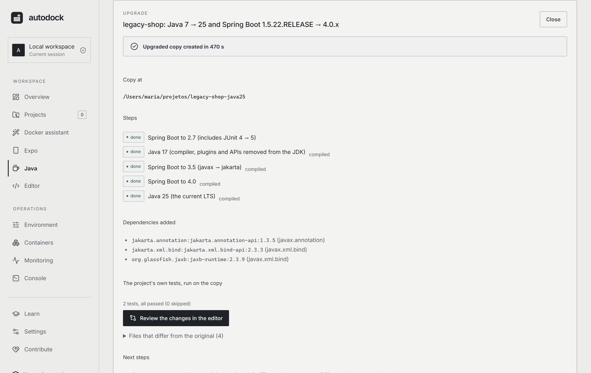</td>
</tr>
</table>

#### A folder with no `pom.xml`

An old Ant or Eclipse project has no `pom.xml`, so AutoDock first **maps** the folder and then, if you want, **turns it into a Maven project in a copy** (`autodock java map` and `autodock java convert` do the same from the terminal). The copy is a normal Maven project: the upgrade above takes it from there (a small Ant project went from Java 8 to Java 25, with its test passing, in 24 seconds once Docker already had the Maven image and the dependencies cached).

<table>
<tr>
<td width="50%"><b>The map</b><br/>Build files, where the sources really are (from each <code>package</code>), libraries, main classes and the Java level the project files declare.<br/>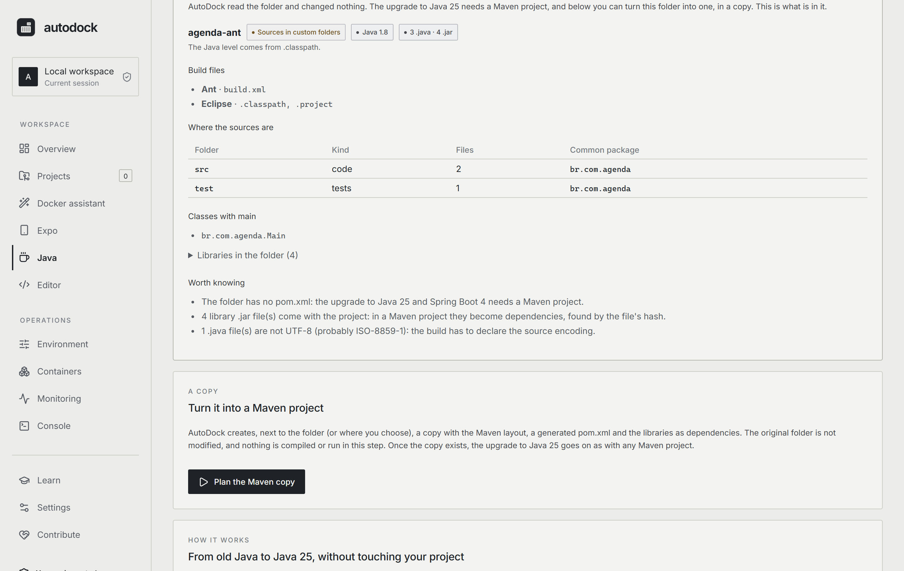</td>
<td width="50%"><b>The Maven copy</b><br/>Coordinates you can change, the dependencies found from the jar names, the <code>pom.xml</code> as it will be written and a confirmation.<br/>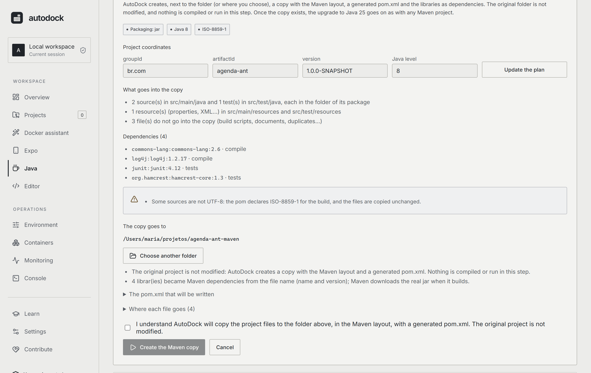</td>
</tr>
</table>

### 💻 Code editor and terminal

Open a project folder, or the upgraded copy straight from the Java report, and work on it without leaving AutoDock. The editor is [Monaco](https://microsoft.github.io/monaco-editor/), the one of VS Code. After an upgrade it shows the original and the copy **side by side**; the search covers every file of the project; and the **terminal** runs your commands (`mvn test`, `npm run build`…) **inside a Docker container** that has the folder mounted, in a Java, Node.js, Python or Debian image, so nothing runs loose on your computer. [Security rules](docs/SECURITY.md).

<table>
<tr>
<td width="50%"><b>Side by side</b><br/>The original on the left, the upgraded copy (editable) on the right.<br/>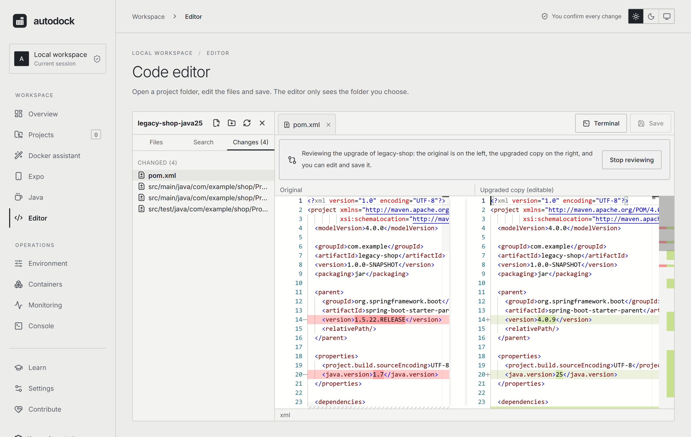</td>
<td width="50%"><b>Search and terminal</b><br/>Find text in every file, and run commands in a container.<br/>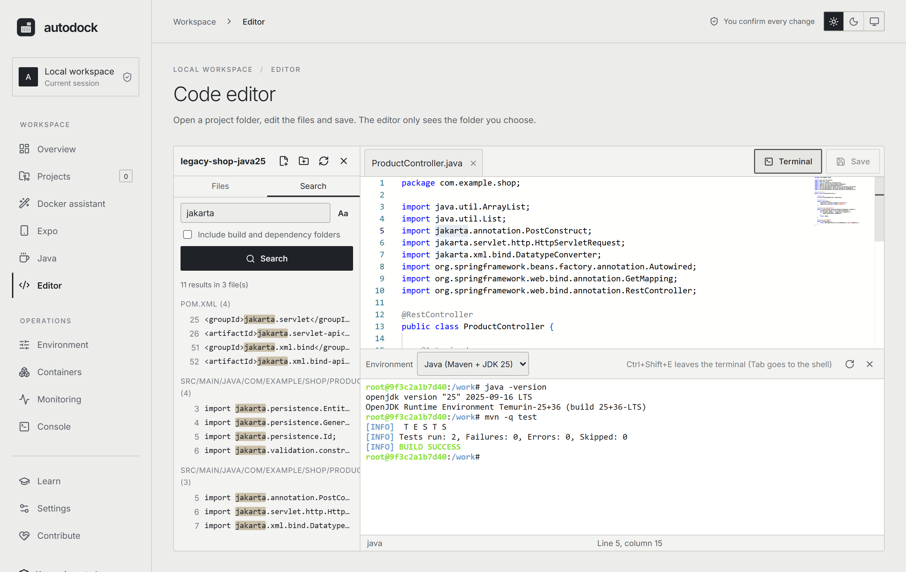</td>
</tr>
</table>

### 🌗 Light and dark

<table>
<tr>
<td width="50%"><b>Light</b><br/></td>
<td width="50%"><b>Dark</b><br/>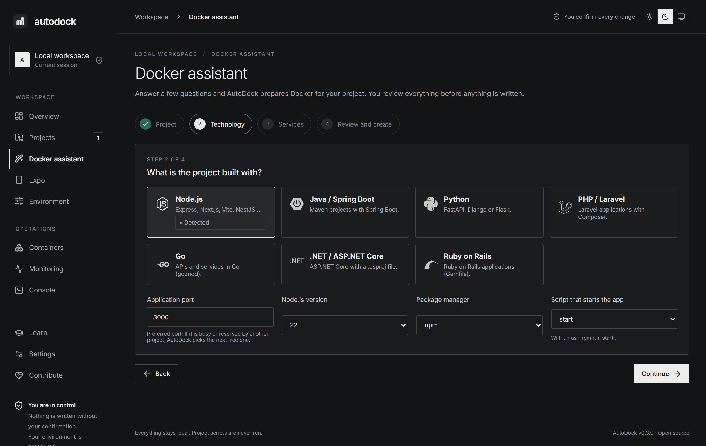</td>
</tr>
</table>

## 🔄 How it works

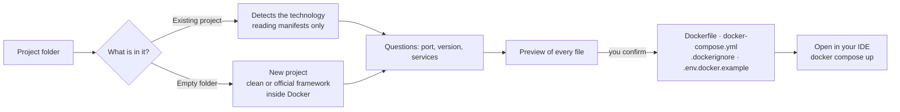

## 🛡️ Security principles

AutoDock touches your files, so trust comes first:

- **Preview before writing.** The content is generated in the backend from validated options; the interface never sends file contents.
- **Never overwrites.** Files are created exclusively; symlinks are not followed.
- **Passwords outside the compose file.** 32-character passwords (system CSPRNG) go to `.env.docker`, with restricted permissions, and the preview shows exactly what will be written. `.env.docker.example` only lists variable names.
- **Allowlisted inputs.** Ports, versions, names and scripts are validated, so there is no injection into Dockerfiles, YAML or command lines.
- **No shell.** Editors and installers are started with fixed arguments, never with assembled text.
- **Isolated framework installers.** They run in a throwaway container with **only** the empty folder mounted.
- **Service ports on `127.0.0.1` only.** Databases and queues are not exposed to your network.
- **Never reads `.env`** nor runs scripts of the analyzed projects.
- **Expo upgrades are isolated and reversible.** The package manager runs inside a throwaway container (`node:22-bookworm-slim`) that sees the project folder but gets its own empty `node_modules`, so install scripts never run on your computer. Only `package.json` and the lock file change; they are backed up outside the project first and put back automatically if the upgrade fails (or on demand, later).
- **Java upgrades never touch your project.** AutoDock copies the folder (without `.git`, `.env` files, `target`, `node_modules` and symbolic links) and does everything in the copy, **inside a throwaway container** (`maven:3.9-eclipse-temurin-25`). Maven and the project's build plugins never run on your computer. The downloaded dependencies stay in a Docker volume (`autodock-maven-cache`), and the only network access is Maven Central, which Maven itself contacts from the container.
- **One optional network request.** The latest Expo SDK is read from the npm registry (`registry.npmjs.org`, the version list of the `expo` package; nothing from your projects is sent), only when you press *Check now* or turned on the automatic check (off by default, at most once a day). Watched projects are stored as plain folder paths in `~/.autodock/expo.json`, and only the ones you add.
- **Updates are signed and ask first.** The app only installs an update whose signature matches the public key built into it, downloaded over HTTPS from this repository's releases. It checks when it opens (at most once a day, one request to GitHub with no data about you or your projects; you can turn it off in Settings), and nothing is installed until you click *Update now*.
- **Running is explicit.** The only thing AutoDock executes beyond reading is `docker compose` (up, stop, down), and only after you tick a confirmation. It uses fixed arguments and a compose file of the project root, and it never removes volumes or images. Note that building the images runs the steps of the Dockerfiles, and starting the containers runs your app, both inside Docker.

Details in [`docs/SECURITY.md`](docs/SECURITY.md).

## ⌨️ Command line

Everything the assistant does is also available in the terminal (`cargo run -p autodock-cli -- …`):

```bash
# the CLI follows your system language; force it with --lang pt or --lang en
# analyze a project and diagnose the environment
autodock scan ./my-project
autodock doctor

# show the preview (nothing is written)...
autodock generate ./my-project --stack nodejs --port 3000 --service postgres --service redis
# ...and write only the new files
autodock generate ./my-project --stack nodejs --port 3000 --service postgres --write

# new project in an empty folder
autodock generate ./new --new --stack python --port 8000 --write
# stacks: nodejs, spring-boot, python, laravel, go, dotnet, rails
autodock generate ./api --stack go --port 8080 --service postgres
autodock scaffold ./new --framework laravel --name shop          # only shows the command
autodock scaffold ./new --framework laravel --name shop --run    # runs it
# frameworks: laravel, django, vite-react, vite-vue, nextjs, nestjs
autodock scaffold ./site --framework nextjs --name site

# projects with several apps (monorepo, microservices)
autodock apps ./shop                                   # which apps are there
autodock multi ./shop --service postgres               # preview: one Dockerfile per app + compose
autodock multi ./shop --service postgres --write       # write the new files
autodock compose ./shop up --yes                       # docker compose up -d --build (also: stop, down, status)

# Expo projects: SDK, alerts and upgrade
autodock expo inspect ./app                            # SDK, package manager, generated native folders
autodock expo watch ./app                              # keep an eye on this project (only its path is stored)
autodock expo check                                    # latest stable SDK on npm vs your watched projects
autodock expo plan ./app                               # what the upgrade to the next SDK would do (runs nothing)
autodock expo upgrade ./app --yes                      # runs it in Docker, with a backup (also: backups, restore --yes)

# Legacy Java (Maven): upgrade a copy to the current JDK and Spring Boot
autodock java inspect ./old-app                        # Java level, Spring Boot, APIs the JDK removed (reads only)
autodock java map ./old-app                            # no pom.xml? build files, source folders, libraries, main classes (reads only)
autodock java convert ./old-app                        # plan: the Maven copy of a folder without a pom.xml (writes nothing)
autodock java convert ./old-app --yes                  # creates ./old-app-maven with the Maven layout and a generated pom.xml
autodock java plan ./old-app                           # the steps, the dependencies to add and where the copy goes
autodock java upgrade ./old-app --yes                  # creates ./old-app-java25 in Docker; the original is never modified
autodock java upgrade ./old-app --into ~/backups --yes # the same, with the copy created inside ~/backups
```

## 🧱 Architecture

```
crates/autodock-core   Rust core: scanner, generator, installers, IDEs, Docker (no UI)
crates/autodock-cli    Command line (Clap)
apps/desktop           React + Vite interface, packaged with Tauri 2
docs/                  Architecture, security, roadmap and development guide
```

To run from source, see the [development guide](docs/DEVELOPMENT.md).

```bash
npm --prefix apps/desktop ci
npm --prefix apps/desktop run tauri dev
```

## 🗺️ Roadmap

- [x] Projects with several apps: one container per app, run everything with one click
- [x] Docker assistant for existing projects (Node.js, Next.js, NestJS, Spring Boot, Python, Laravel, Go, .NET, Rails)
- [x] Services: PostgreSQL, MySQL, MongoDB, Redis, RabbitMQ, Adminer, MailHog
- [x] New project: clean or with the official installer (Laravel, Django, Vite, Next.js, NestJS)
- [x] Open the project in the installed IDE
- [x] Installers for macOS, Windows and Linux
- [x] Interface in English and Portuguese
- [x] Light and dark themes
- [x] Learn area (lessons, quick reference, glossary)
- [x] Containers and images named after your project
- [ ] Spring Initializr (choose dependencies)
- [x] Expo: detect the SDK, alert when a newer stable one is out and upgrade with backup
- [x] Java: upgrade a legacy Maven project to the current JDK and Spring Boot (in a copy)
- [x] Java: map a folder without a Maven project (build files, source folders, libraries)
- [x] Java: turn such a folder into a Maven project (a copy with a generated `pom.xml`; libraries from their file name)
- [ ] Java: find the libraries by the hash of each `.jar` (Maven Central)
- [x] Code editor inside the app (explorer, tabs, save)
- [x] Editor: review a Java upgrade side by side with the original
- [x] Editor: search in all files
- [x] Editor: integrated terminal (in a Docker container)
- [ ] Editor: extensions
- [ ] Gradle and more services (Kafka, MinIO…)
- [ ] Production Dockerfiles (multi-stage)
- [x] Updates inside the app (signed, with your confirmation)
- [ ] Code signing and notarization of the installers

## 🤝 Contributing

AutoDock is built in the open and every bit of help counts:

- 💬 **Join the [Discord community](https://discord.gg/AqKSFaQ8g3)** to hear about new releases first, ask questions and talk with the people using AutoDock.
- ⭐ **Star the repository** to help other people find the project.
- 🐛 **Report problems** and 💡 **suggest ideas** in the [issues](https://github.com/joaopanucci/autodock/issues).
- 🔧 **Send a pull request.** Read [CONTRIBUTING](CONTRIBUTING.md) and the [development guide](docs/DEVELOPMENT.md).
- 🧪 **Test on Windows and Linux** and tell us how it went.
- 💙 **Support with a PIX.** The app has a **Contribute** tab with a QR code (PIX is a Brazilian instant payment system). It is voluntary and no feature depends on it.

## 📄 License

[Apache-2.0](LICENSE) © AutoDock contributors.

<div align="center"><sub>Made with 🦀 Rust, ⚛️ React and 🐳 Docker.</sub></div>
