<div align="center">

**🌐 [English](README.md) · Português (Brasil)**

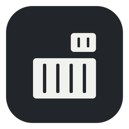

# AutoDock

**Coloque qualquer projeto no Docker em poucos cliques.**<br/>
Responda algumas perguntas. O AutoDock cria o `Dockerfile`, o `docker-compose.yml` e até o projeto, se você ainda não tiver um. Você revisa tudo antes de gravar.

[](https://github.com/joaopanucci/autodock/actions/workflows/rust-ci.yml)
[](https://github.com/joaopanucci/autodock/releases/latest)
[](LICENSE)


[](CONTRIBUTING.pt-BR.md)

[**Baixar**](#-baixar) · [**Passo a passo**](#-passo-a-passo) · [**CLI**](#-linha-de-comando) · [**Contribuir**](#-contribuir)

<br/>

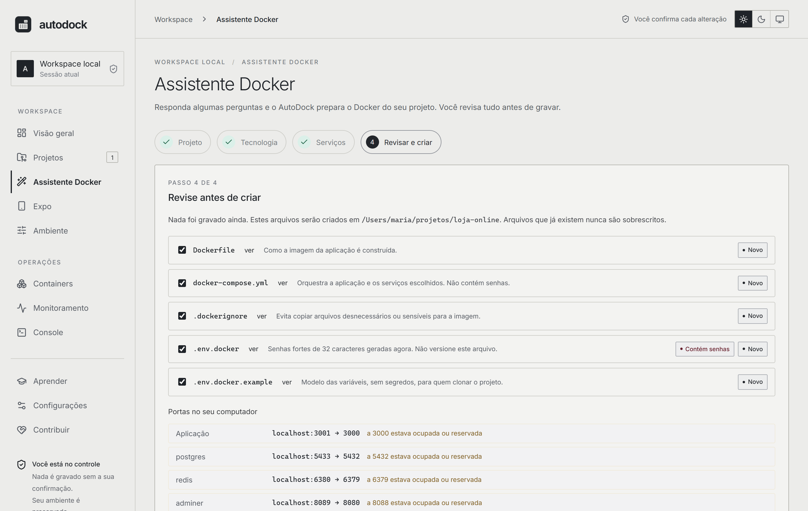

</div>

<br/>

## ✨ Por que o AutoDock?

Configurar Docker para um projeto local é repetitivo: qual imagem base, qual porta, como ligar o banco, o que ignorar na imagem. O AutoDock transforma isso em uma conversa.

- 🧭 **Guiado.** Pergunta o que importa (tecnologia, porta, versão, bancos, cache) e cuida do resto.
- 👀 **Transparente.** Mostra cada arquivo e cada comando **antes** de qualquer alteração.
- 🛡️ **Seguro por padrão.** Nunca sobrescreve arquivos, nunca lê o seu `.env`, nunca executa scripts do seu projeto.
- 🔐 **Senhas fortes de verdade.** Cada serviço ganha uma senha aleatória de 32 caracteres (gerador criptográfico do sistema), guardada em `.env.docker`. O `docker-compose.yml` não contém nenhuma senha.
- 🔌 **Sem conflito de portas.** O AutoDock testa quais portas estão livres e lembra as de outros projetos, então 10 projetos não disputam a 5432.
- 🧰 **Sem instalar nada além do Docker.** Os instaladores oficiais dos frameworks rodam *dentro* de containers.
- 🖥️ **Local e open source.** Seu código não sai do seu computador. Licença Apache-2.0.
- 🏷️ **Com o nome do seu projeto.** O projeto do compose, os containers e as imagens levam o nome do seu projeto (`loja`, `loja-postgres`…), nunca um nome genérico.
- 🌗 **Claro e escuro.** Troque o tema em qualquer tela; ele também pode seguir o sistema.
- 🎓 **Aprenda usando.** 13 lições curtas, um guia rápido com comandos para PowerShell, CMD e Bash e um glossário, tudo dentro do app.
- 🌍 **Português e inglês.** A interface e as mensagens seguem o idioma do sistema e podem ser trocadas em Configurações.

## 🚀 O que ele faz

| | |
|---|---|
| **Projeto existente** | Detecta a tecnologia lendo os manifests e gera `Dockerfile`, `docker-compose.yml`, `.dockerignore` e `.env.docker.example`. |
| **Projeto novo, em pasta vazia** | Cria um projeto *limpo* ou usa o **instalador oficial** do framework, tudo dentro do Docker. |
| **Serviços prontos** | PostgreSQL, MySQL, MongoDB, Redis, RabbitMQ, Adminer e MailHog, já conectados ao app por variáveis de ambiente, com healthchecks, **senhas fortes geradas** e **portas livres escolhidas automaticamente**. |
| **Vários apps (monorepos, microsserviços)** | Encontra cada app da pasta (backend, front end, mobile…), escreve **um Dockerfile por app** e **um compose** que roda todos juntos com os serviços compartilhados, já ligados entre si (o front end recebe o endereço do backend). Dockerfiles e compose que já existem são reaproveitados, nunca sobrescritos. |
| **Subir tudo** | Um botão (depois da sua confirmação) roda `docker compose up -d --build`, mostra o estado de cada serviço e permite parar ou remover os containers. Os volumes (seus dados) nunca são removidos. |
| **Expo: aviso de SDK e atualização** | Mostra o SDK dos seus projetos Expo e avisa quando sai um SDK **estável** mais novo ("seu projeto está no SDK 57, mas o Expo lançou o SDK 58: atualizar?"). A atualização segue os passos oficiais (`expo install`, `expo install --fix`, `expo-doctor`) **dentro do Docker**, um SDK por vez, com backup do `package.json` e do arquivo de lock que volta sozinho se algo falhar. |
| **Java: atualização de projeto legado** | Lê um projeto Maven antigo (Java 6/7/8, Spring Boot 1.x/2.x) e cria, **ao lado dele** (ou na pasta que você escolher), uma cópia atualizada para o **Java 25 e o Spring Boot 4**: sobe a cópia um passo por vez (Spring Boot 2.7, Java 17, Spring Boot 3.5 com `javax` → `jakarta`, Spring Boot 4, Java 25) com o [OpenRewrite](https://docs.openrewrite.org/) **dentro do Docker**, compila depois de cada passo, adiciona as dependências das APIs que o JDK deixou de trazer (JAXB, `javax.annotation`…) e roda os testes do próprio projeto. O seu projeto nunca é alterado. |
| **Atualização dentro do app** | Quando sai uma versão nova, o AutoDock avisa e se atualiza com um clique (sem baixar de novo). A atualização é **verificada por assinatura** antes de ser instalada, nada é instalado sem o seu clique, e a verificação (uma vez por dia, uma requisição ao GitHub) pode ser desligada em Configurações. |
| **Abrir na sua IDE** | Depois de criar, abre o projeto no VS Code, Cursor, Windsurf, IntelliJ, WebStorm, PyCharm, PhpStorm, Zed ou Sublime que você tiver instalado. |
| **Visão do ambiente** | Analisa projetos, diagnostica o seu ambiente, lista containers, mostra métricas e logs, tudo em modo leitura. |

### Tecnologias

| Tecnologia | Projeto existente | Projeto novo (limpo) | Projeto novo (framework oficial) |
|---|:---:|:---:|:---:|
| **Node.js** | ✅ npm · pnpm · yarn, Vite, Next.js, NestJS | ✅ Express | ✅ Vite + React · Vite + Vue · Next.js · NestJS (TypeScript) |
| **Java / Spring Boot** | ✅ Maven | ✅ Spring Boot + Maven | 🔜 Spring Initializr |
| **Python** | ✅ FastAPI · Django · Flask | ✅ FastAPI · Flask | ✅ Django |
| **PHP / Laravel** | ✅ Composer | — | ✅ Laravel |
| **Go** | ✅ `go.mod` (build em duas etapas) | ✅ `net/http` | — |
| **.NET / ASP.NET Core** | ✅ `.csproj` (build em duas etapas) | ✅ minimal API | — |
| **Ruby on Rails** | ✅ Gemfile | — | — |

## 📦 Baixar

Pegue o instalador da sua plataforma na [página de releases](https://github.com/joaopanucci/autodock/releases/latest):

| Sistema | Arquivo | Como instalar |
|---|---|---|
| 🍎 **macOS** (Intel e Apple Silicon) | [`AutoDock_0.5.1_universal.dmg`](https://github.com/joaopanucci/autodock/releases/download/v0.5.1/AutoDock_0.5.1_universal.dmg) | Abra o DMG e arraste para *Aplicativos*. |
| 🪟 **Windows** (64 bits) | [`AutoDock_0.5.1_x64-setup.exe`](https://github.com/joaopanucci/autodock/releases/download/v0.5.1/AutoDock_0.5.1_x64-setup.exe) | Execute o instalador. |
| 🐧 **Linux** (Debian/Ubuntu) | [`AutoDock_0.5.1_amd64.deb`](https://github.com/joaopanucci/autodock/releases/download/v0.5.1/AutoDock_0.5.1_amd64.deb) | `sudo apt install ./AutoDock_0.5.1_amd64.deb` |
| 🐧 **Linux** (qualquer distro) | [`AutoDock_0.5.1_amd64.AppImage`](https://github.com/joaopanucci/autodock/releases/download/v0.5.1/AutoDock_0.5.1_amd64.AppImage) | `chmod +x AutoDock_*.AppImage && ./AutoDock_*.AppImage` |

> **Requisito:** [Docker](https://docs.docker.com/get-docker/) instalado e em execução para criar e rodar os ambientes.

### ⚡ Instalação rápida, sem aviso de segurança

Um comando baixa a última versão, **confere o SHA-256** e instala:

```bash
# macOS
curl -fsSL https://raw.githubusercontent.com/joaopanucci/autodock/main/scripts/install.sh | bash
```

```powershell
# Windows (PowerShell)
irm https://raw.githubusercontent.com/joaopanucci/autodock/main/scripts/install.ps1 | iex
```

Como o download não passa pelo navegador, o arquivo **não recebe a marca de "baixado da internet"** que dispara o aviso do macOS (Gatekeeper) e do Windows (SmartScreen). Isso não desliga nenhuma proteção do sistema, e o app continua não assinado. Os scripts são curtos e abertos: [`install.sh`](scripts/install.sh) e [`install.ps1`](scripts/install.ps1). Para fixar uma versão: `AUTODOCK_VERSION=v0.5.1`.

<details>
<summary><b>⚠️ Baixou pelo navegador e apareceu "desenvolvedor não identificado"? É esperado</b></summary>

<br/>

O AutoDock é um projeto open source e os instaladores **ainda não são assinados** (assinar exige contas pagas na Apple e na Microsoft). Por isso o sistema mostra um aviso na primeira abertura. O código é público e cada release traz um `SHA256SUMS.txt` para você conferir o arquivo baixado.

- **macOS:** abra o app uma vez, depois vá em **Ajustes do Sistema → Privacidade e Segurança** e clique em **Abrir mesmo assim**. Alternativa no terminal: `xattr -dr com.apple.quarantine /Applications/AutoDock.app`.
- **Windows:** na tela do SmartScreen, clique em **Mais informações** e depois em **Executar assim mesmo**.
- **Linux:** não há aviso.

Conferir a integridade do arquivo:

```bash
shasum -a 256 AutoDock_0.5.1_universal.dmg   # compare com o SHA256SUMS.txt
```

</details>

> 🧪 **Status das plataformas:** a CI compila e testa o núcleo em macOS, Windows e Linux, e gera os três instaladores a cada versão. Os testes manuais do aplicativo completo foram feitos no macOS; relatos de Windows e Linux são muito bem-vindos.

## 🎬 Passo a passo

### 1. Escolha a pasta do projeto

Selecione a pasta. O AutoDock lê **apenas** os arquivos de configuração (`package.json`, `pom.xml`, `requirements.txt`, `composer.json`, `go.mod`, `*.csproj`, `Gemfile`) para sugerir a tecnologia. Nenhum código seu é executado.

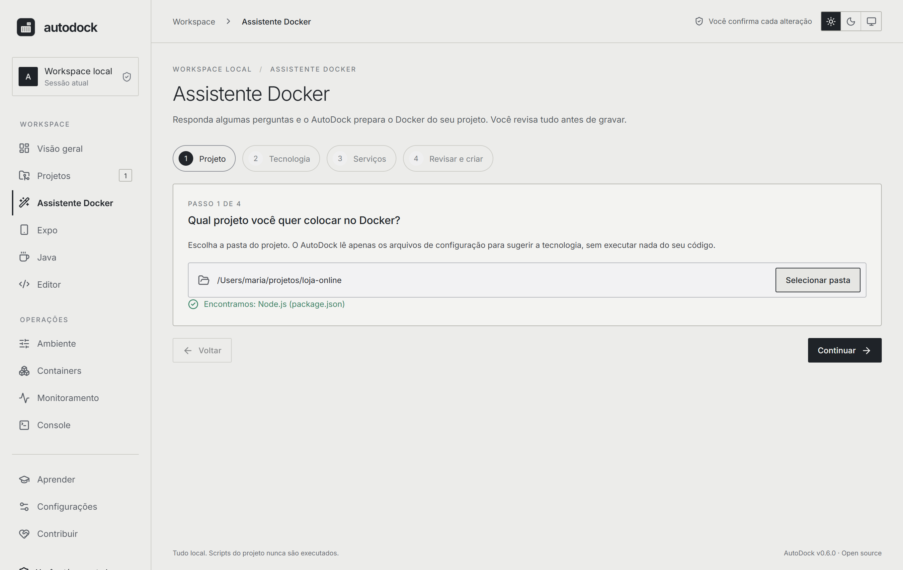

> 💡 **Pasta vazia?** O assistente oferece **Criar projeto novo**: você escolhe a tecnologia, define o nome e decide entre um projeto **limpo** ou o **instalador oficial** do framework (Laravel, Django, Vite + React/Vue). Antes de rodar, ele mostra o comando exato.

### 2. Confirme a tecnologia e responda o essencial

Porta, versão do runtime, gerenciador de pacotes, script de início. Tudo com valores padrão sensatos.

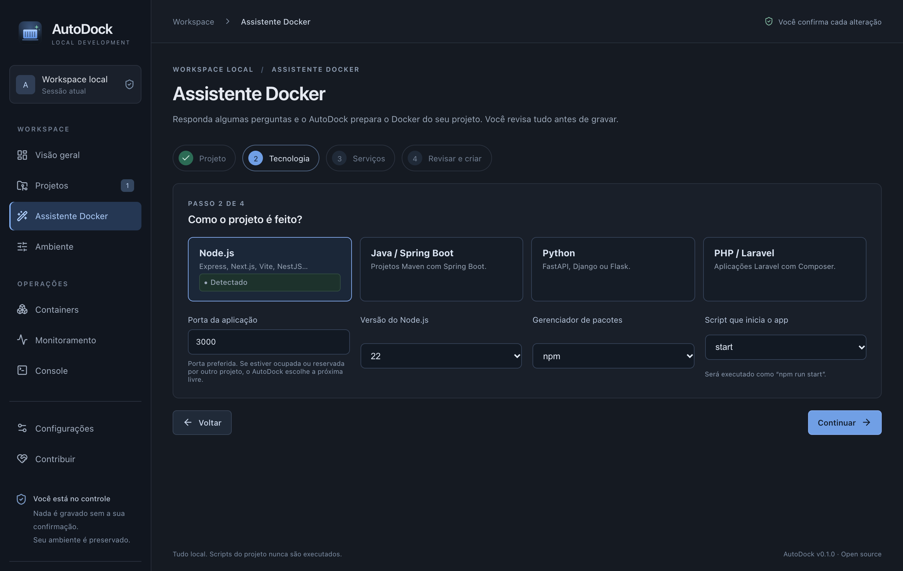

### 3. Escolha os serviços

Marque o que o projeto precisa. Cada item vira um container ao lado do seu app, já conectado.

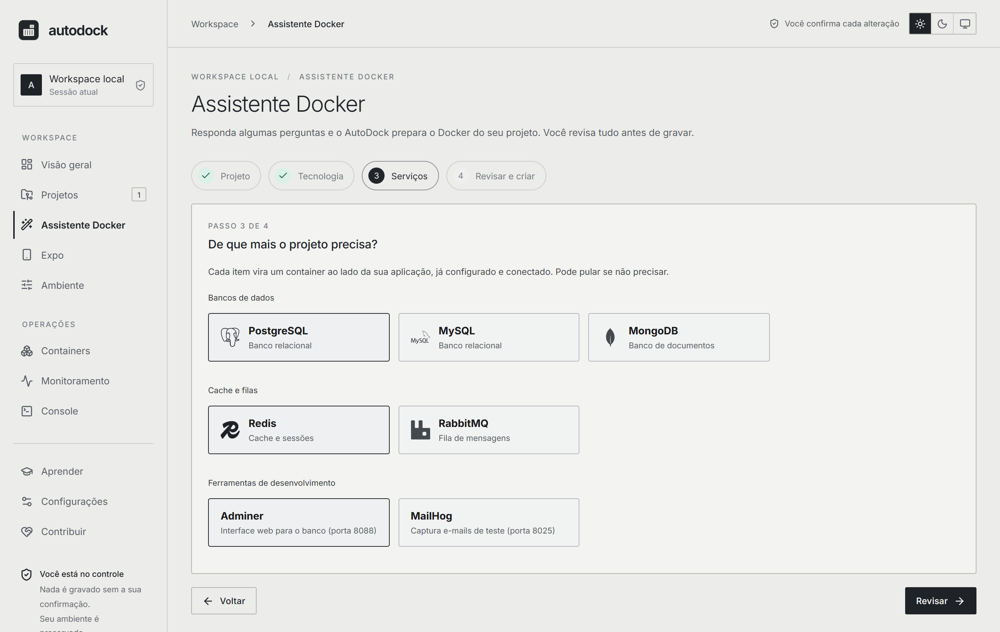

### 4. Revise antes de criar

Veja o conteúdo de cada arquivo. Nada foi gravado ainda. Arquivos que já existem **nunca** são sobrescritos.


### 5. Pronto: abra na sua IDE e suba o ambiente

Um clique abre o projeto no editor que você tem instalado. Depois, é só rodar:

```bash
docker compose up --build
```

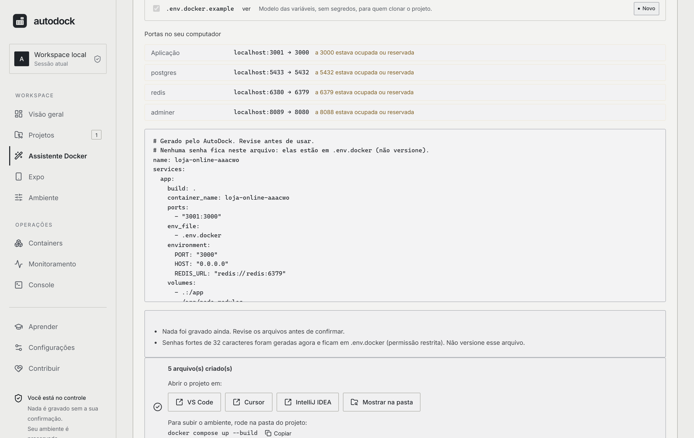

### Além do assistente

<table>
<tr>
<td width="50%"><b>Analise um projeto</b><br/>Tecnologias, módulos e evidências, com a origem de cada informação.<br/>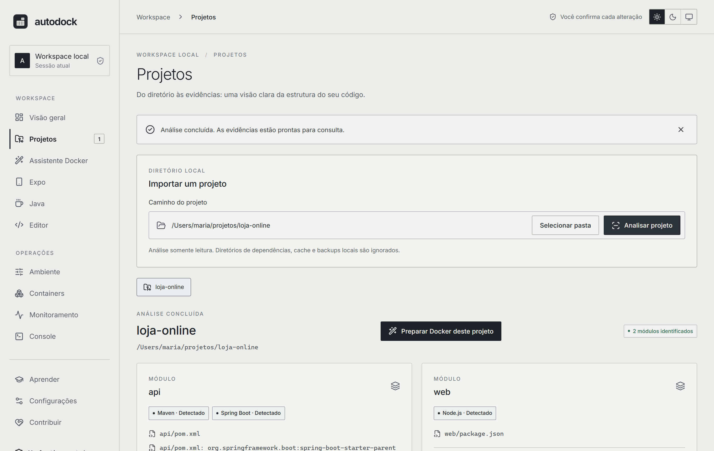</td>
<td width="50%"><b>Veja seus containers</b><br/>Inventário do Docker local, agrupado por projeto, com estado e saúde.<br/>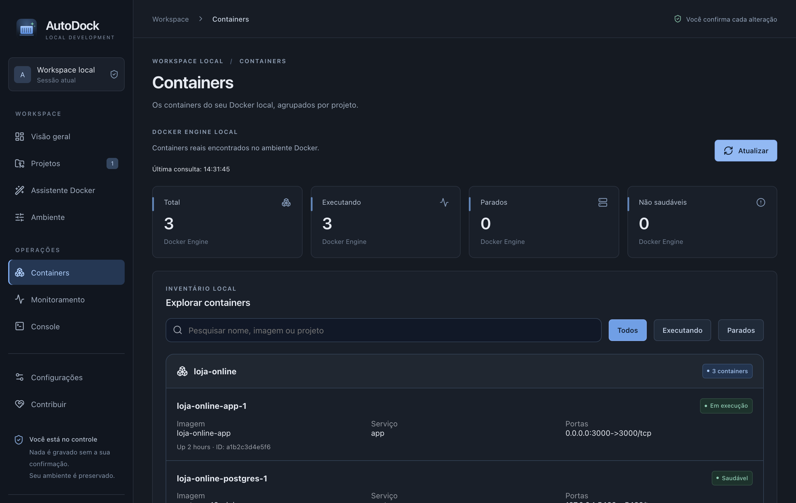</td>
</tr>
<tr>
<td width="50%"><b>Diagnostique o ambiente</b><br/>Node, Git, Docker, Compose e Engine, sem supor nada.<br/>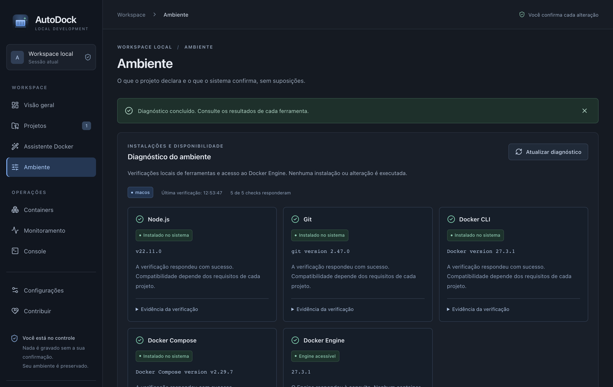</td>
<td width="50%"><b>Visão geral</b><br/>Seus projetos e o estado do ambiente em um só lugar.<br/>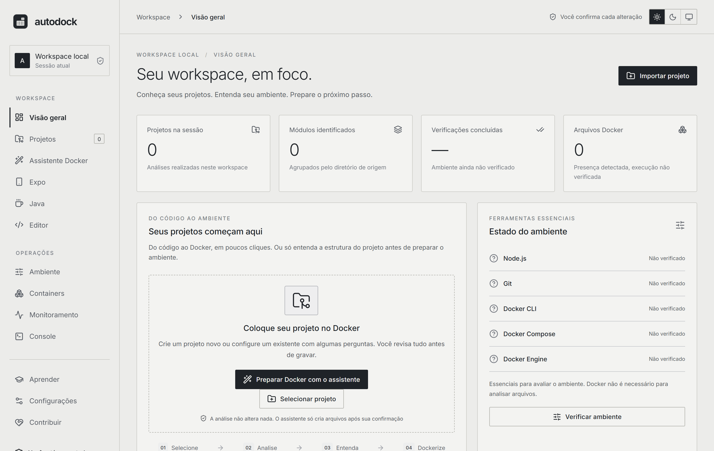</td>
</tr>
</table>

### 📱 Expo: aviso de SDK novo e atualização

Adicione seus projetos Expo e o AutoDock avisa quando sai um SDK **estável** mais novo. A atualização roda os passos oficiais (`expo install`, `expo install --fix`, `expo-doctor`) dentro do Docker, um SDK por vez, depois da sua confirmação, com backup do `package.json` e do arquivo de lock que você pode restaurar. [Mais detalhes nas notas de segurança](docs/SECURITY.md).

<table>
<tr>
<td width="33%"><b>O aviso</b><br/>Em todas as telas, até você atualizar ou dispensar.<br/>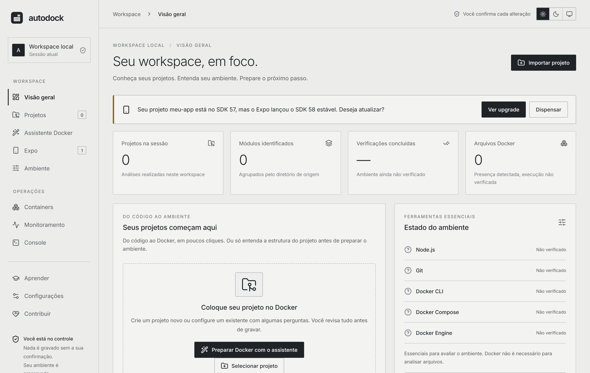</td>
<td width="33%"><b>O plano</b><br/>O que vai acontecer, quais arquivos mudam e o que ler antes.<br/>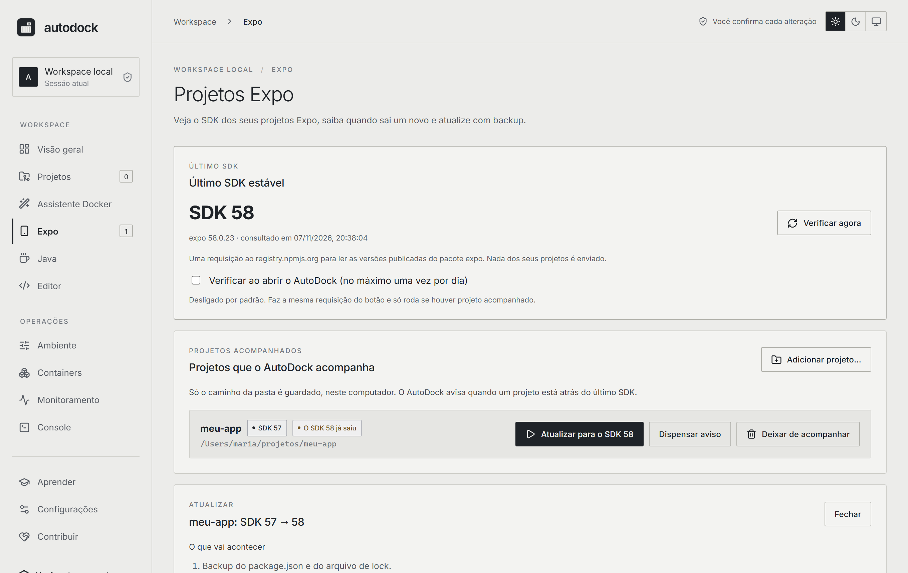</td>
<td width="33%"><b>O relatório</b><br/>Dependências alteradas, o resultado do expo-doctor e os próximos passos.<br/>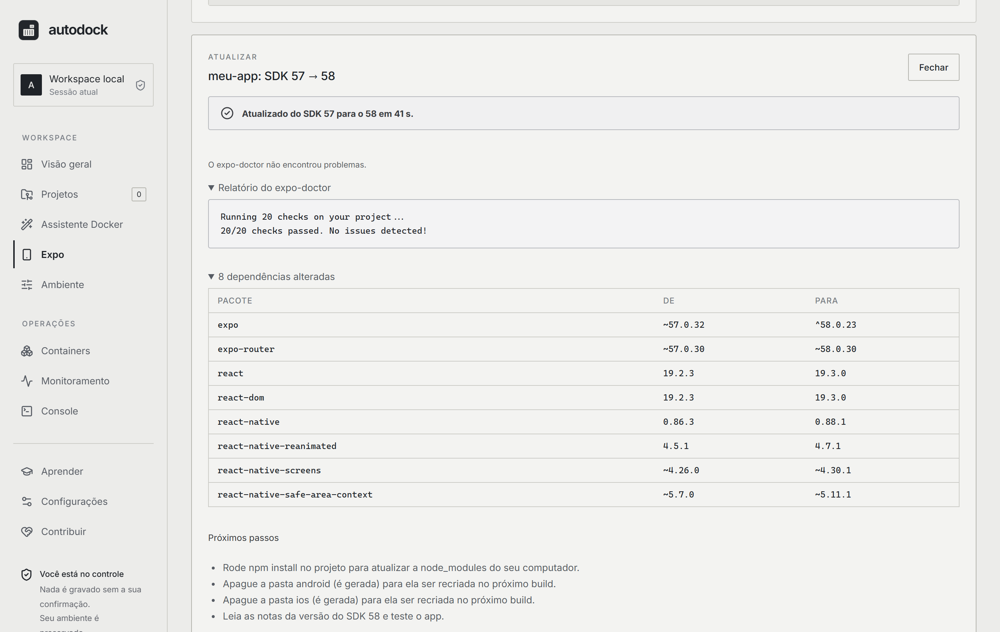</td>
</tr>
</table>

### ☕ Java: atualização de projeto legado

Escolha um projeto Maven e o AutoDock mostra o nível do Java e a versão do Spring Boot, monta o plano e, depois da sua confirmação, cria uma cópia atualizada (`<nome>-java25`) ao lado da pasta, ou na pasta que você escolher. Cada passo é compilado: se algo quebrar, o relatório diz em qual passo e mostra os erros do compilador. Projetos Spring Boot sobem uma linha principal por vez; projetos sem Spring só mudam o nível do Java. Gradle ainda não é suportado. [Mais detalhes nas notas de segurança](docs/SECURITY.md).

### 🌗 Claro e escuro

<table>
<tr>
<td width="50%"><b>Claro</b><br/></td>
<td width="50%"><b>Escuro</b><br/>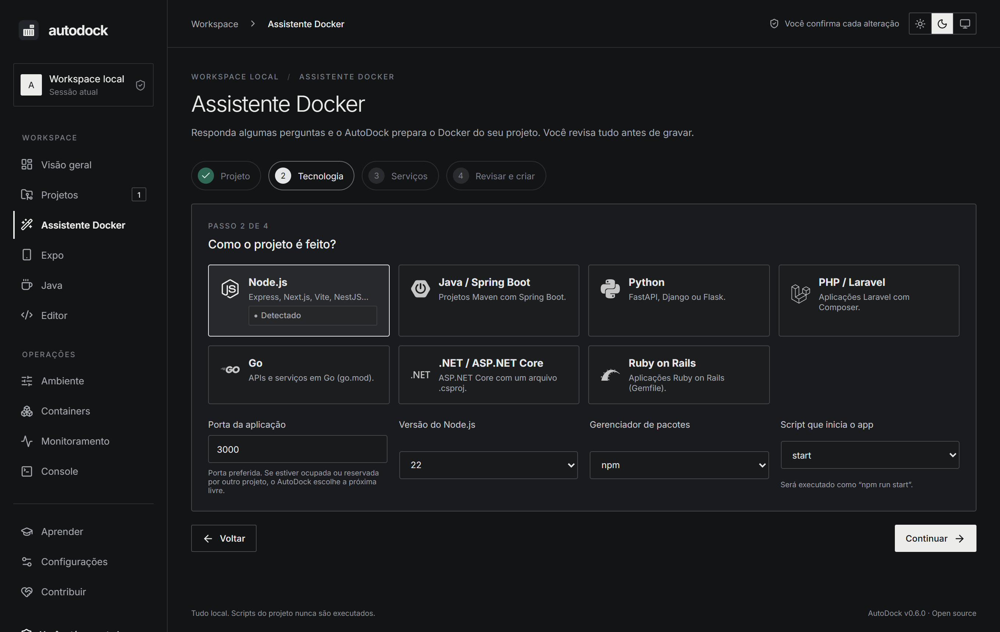</td>
</tr>
</table>

## 🔄 Como funciona

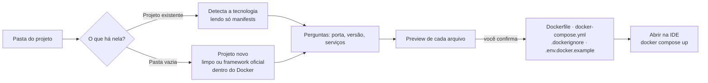

## 🛡️ Princípios de segurança

O AutoDock mexe nos seus arquivos, então a confiança vem primeiro:

- **Preview antes de gravar.** O conteúdo é gerado no backend a partir de opções validadas; a interface nunca envia o conteúdo dos arquivos.
- **Nunca sobrescreve.** Criação exclusiva de arquivos; symlinks não são seguidos.
- **Senhas fora do compose.** Senhas de 32 caracteres (CSPRNG do sistema) ficam em `.env.docker`, com permissão restrita, e a pré-visualização mostra exatamente o que será gravado. O arquivo `.env.docker.example` traz só os nomes das variáveis.
- **Entradas por lista permitida.** Portas, versões, nomes e scripts são validados, então não há injeção em Dockerfile, YAML ou linha de comando.
- **Sem shell.** Editores e instaladores são iniciados com argumentos fixos, nunca por texto montado.
- **Instaladores de framework isolados.** Rodam em um container descartável com **apenas** a pasta vazia montada.
- **Portas dos serviços só em `127.0.0.1`.** Bancos e filas não ficam expostos na sua rede.
- **Nunca lê `.env`** nem executa scripts dos projetos analisados.
- **Atualizar o Expo é isolado e reversível.** O gerenciador de pacotes roda dentro de um container descartável (`node:22-bookworm-slim`) que enxerga a pasta do projeto mas usa uma `node_modules` vazia só dele, então scripts de instalação nunca rodam no seu computador. Só o `package.json` e o arquivo de lock mudam; antes eles ganham um backup fora do projeto e voltam sozinhos se o upgrade falhar (ou quando você pedir, depois).
- **Atualizar Java nunca toca no seu projeto.** O AutoDock copia a pasta (sem `.git`, arquivos `.env`, `target`, `node_modules` e links simbólicos) e faz tudo na cópia, **dentro de um container descartável** (`maven:3.9-eclipse-temurin-25`). O Maven e os plugins de build do projeto nunca rodam no seu computador. As dependências baixadas ficam num volume do Docker (`autodock-maven-cache`) e o único acesso à internet é ao Maven Central, que o próprio Maven consulta de dentro do container.
- **Uma consulta opcional à internet.** O último SDK do Expo é lido do registry do npm (`registry.npmjs.org`, a lista de versões do pacote `expo`; nada dos seus projetos é enviado), só quando você aperta *Verificar agora* ou liga a verificação automática (desligada por padrão, no máximo uma vez por dia). Os projetos acompanhados ficam como caminhos de pasta em `~/.autodock/expo.json`, e só os que você adicionar.
- **Atualizações são assinadas e pedem confirmação.** O app só instala uma atualização cuja assinatura bata com a chave pública embutida nele, baixada por HTTPS dos releases deste repositório. Ele verifica ao abrir (no máximo uma vez por dia, com uma requisição ao GitHub sem dados sobre você ou seus projetos; dá para desligar em Configurações), e nada é instalado até você clicar em *Atualizar agora*.
- **Executar é explícito.** A única coisa que o AutoDock executa além de ler é o `docker compose` (up, stop, down), e só depois de você marcar uma confirmação. Ele usa argumentos fixos e um arquivo compose da raiz do projeto, e nunca remove volumes nem imagens. Atenção: construir as imagens roda os passos dos Dockerfiles e subir os containers roda o seu app, ambos dentro do Docker.

Detalhes em [`docs/SECURITY.md`](docs/SECURITY.md).

## ⌨️ Linha de comando

Tudo que o assistente faz também está disponível no terminal (`cargo run -p autodock-cli -- …`):

```bash
# a CLI segue o idioma do sistema; force com --lang pt ou --lang en
# analisa um projeto e diagnostica o ambiente
autodock scan ./meu-projeto
autodock doctor

# mostra o preview (nada é gravado)...
autodock generate ./meu-projeto --stack nodejs --port 3000 --service postgres --service redis
# ...e grava só os arquivos novos
autodock generate ./meu-projeto --stack nodejs --port 3000 --service postgres --write

# projeto novo em pasta vazia
autodock generate ./novo --new --stack python --port 8000 --write
# stacks: nodejs, spring-boot, python, laravel, go, dotnet, rails
autodock generate ./api --stack go --port 8080 --service postgres
autodock scaffold ./novo --framework laravel --name loja          # só mostra o comando
autodock scaffold ./novo --framework laravel --name loja --run    # executa
# frameworks: laravel, django, vite-react, vite-vue, nextjs, nestjs
autodock scaffold ./site --framework nextjs --name site

# projetos com vários apps (monorepo, microsserviços)
autodock apps ./loja                                   # quais apps existem
autodock multi ./loja --service postgres               # preview: um Dockerfile por app + compose
autodock multi ./loja --service postgres --write       # grava os arquivos novos
autodock compose ./loja up --yes                       # docker compose up -d --build (também: stop, down, status)

# projetos Expo: SDK, avisos e atualização
autodock expo inspect ./app                            # SDK, gerenciador de pacotes, pastas nativas geradas
autodock expo watch ./app                              # acompanhar este projeto (só o caminho é guardado)
autodock expo check                                    # último SDK estável no npm vs seus projetos acompanhados
autodock expo plan ./app                               # o que a atualização para o próximo SDK faria (não executa nada)
autodock expo upgrade ./app --yes                      # executa no Docker, com backup (também: backups, restore --yes)

# Java legado (Maven): atualiza uma cópia para o JDK e o Spring Boot atuais
autodock java inspect ./app-antigo                     # nível do Java, Spring Boot, APIs que o JDK removeu (só lê)
autodock java plan ./app-antigo                        # os passos, as dependências a adicionar e onde a cópia vai
autodock java upgrade ./app-antigo --yes               # cria ./app-antigo-java25 no Docker; o original nunca é alterado
autodock java upgrade ./app-antigo --into ~/backups --yes # o mesmo, com a cópia criada dentro de ~/backups
```

## 🧱 Arquitetura

```
crates/autodock-core   Núcleo em Rust: scanner, gerador, instaladores, IDEs, Docker (sem UI)
crates/autodock-cli    Linha de comando (Clap)
apps/desktop           Interface React + Vite, empacotada com Tauri 2
docs/                  Arquitetura, segurança, roadmap e guia de desenvolvimento
```

Rodar a partir do código-fonte: veja o [guia de desenvolvimento](docs/DEVELOPMENT.pt-BR.md).

```bash
npm --prefix apps/desktop ci
npm --prefix apps/desktop run tauri dev
```

## 🗺️ Roadmap

- [x] Projetos com vários apps: um container por app e subir tudo com um clique
- [x] Assistente Docker para projetos existentes (Node.js, Next.js, NestJS, Spring Boot, Python, Laravel, Go, .NET, Rails)
- [x] Serviços: PostgreSQL, MySQL, MongoDB, Redis, RabbitMQ, Adminer, MailHog
- [x] Projeto novo: limpo ou com instalador oficial (Laravel, Django, Vite, Next.js, NestJS)
- [x] Abrir o projeto na IDE instalada
- [x] Instaladores para macOS, Windows e Linux
- [ ] Spring Initializr (escolher dependências)
- [x] Expo: detectar o SDK, avisar quando sai um estável mais novo e atualizar com backup
- [x] Java: atualizar um projeto Maven legado para o JDK e o Spring Boot atuais (numa cópia)
- [ ] Gradle e mais serviços (Kafka, MinIO…)
- [ ] Dockerfiles de produção (multi-stage)
- [x] Atualização dentro do app (assinada, com a sua confirmação)
- [ ] Assinatura e notarização dos instaladores
- [x] Interface em inglês e português
- [x] Temas claro e escuro
- [x] Área Aprender (lições, guia rápido, glossário)
- [x] Containers e imagens com o nome do seu projeto

## 🤝 Contribuir

O AutoDock é feito de forma aberta e toda ajuda conta:

- ⭐ **Dê uma estrela** para ajudar outras pessoas a encontrarem o projeto.
- 🐛 **Relate problemas** e 💡 **sugira ideias** nas [issues](https://github.com/joaopanucci/autodock/issues).
- 🔧 **Envie um pull request.** Leia o [CONTRIBUTING](CONTRIBUTING.pt-BR.md) e o [guia de desenvolvimento](docs/DEVELOPMENT.pt-BR.md).
- 🧪 **Teste no Windows e no Linux** e conte como foi.
- 💙 **Apoie com um PIX.** O app tem uma aba **Contribuir** com um QR Code. É voluntário e nenhum recurso depende dele.

## 📄 Licença

[Apache-2.0](LICENSE) © AutoDock contributors.

<div align="center"><sub>Feito com 🦀 Rust, ⚛️ React e 🐳 Docker.</sub></div>
